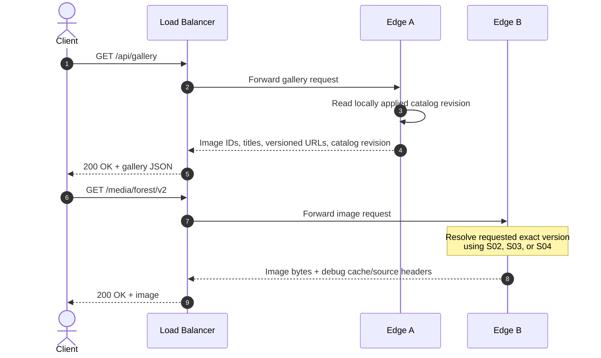
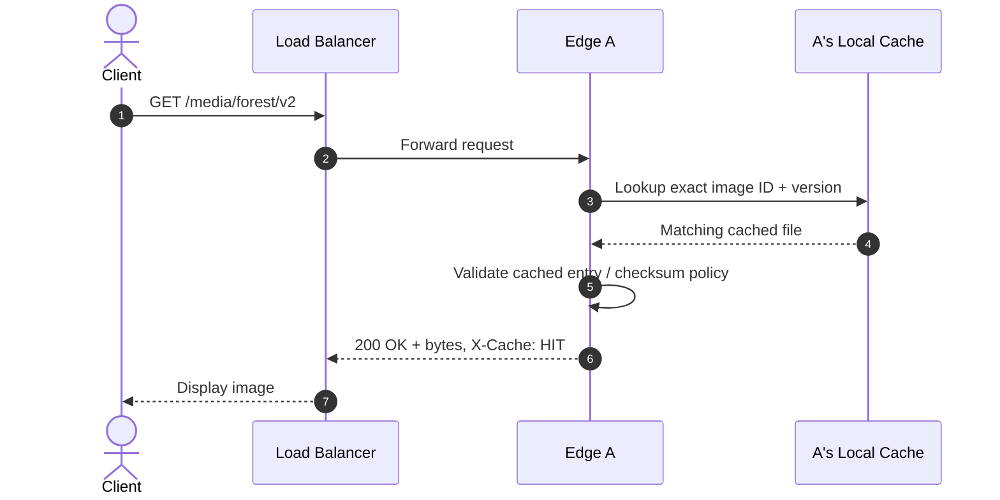
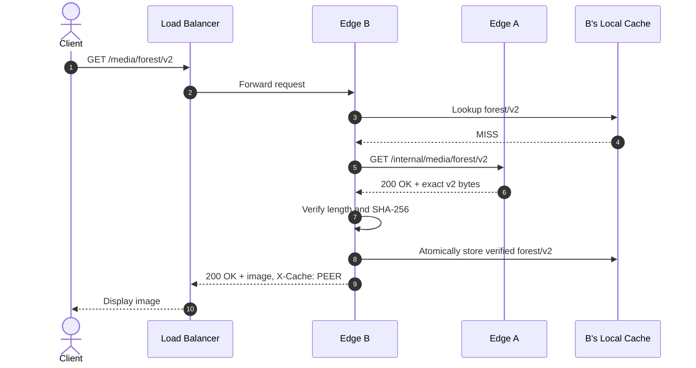
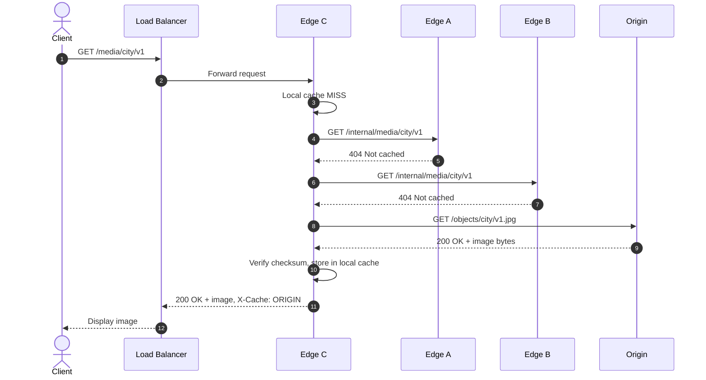
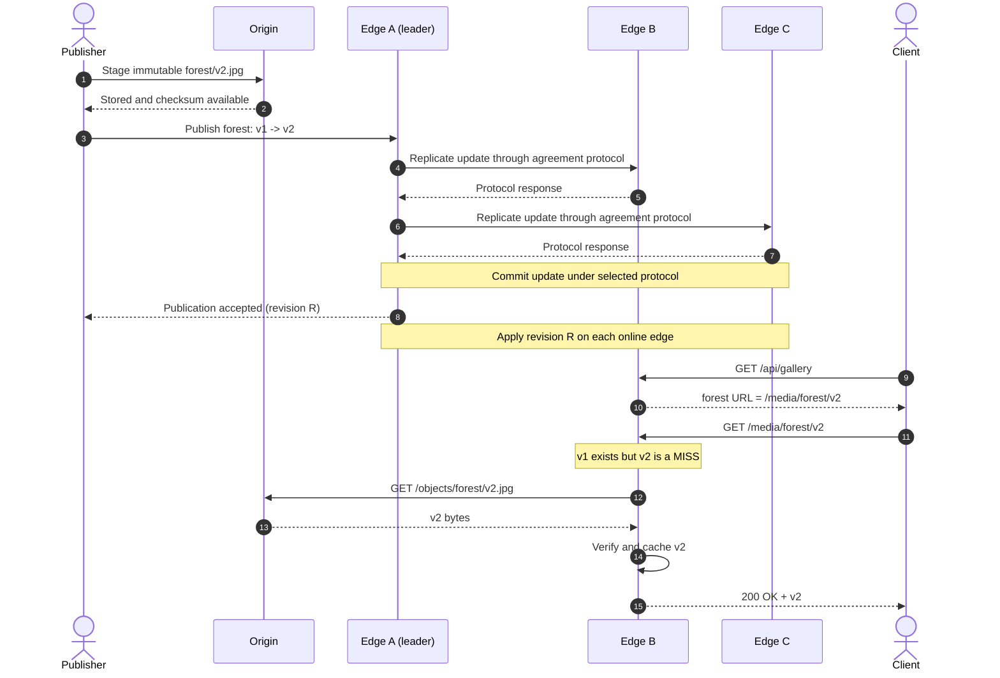
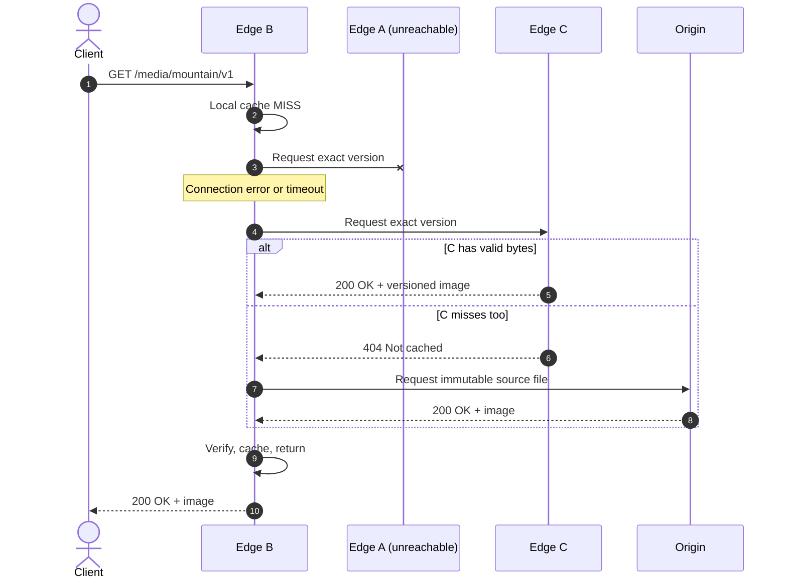
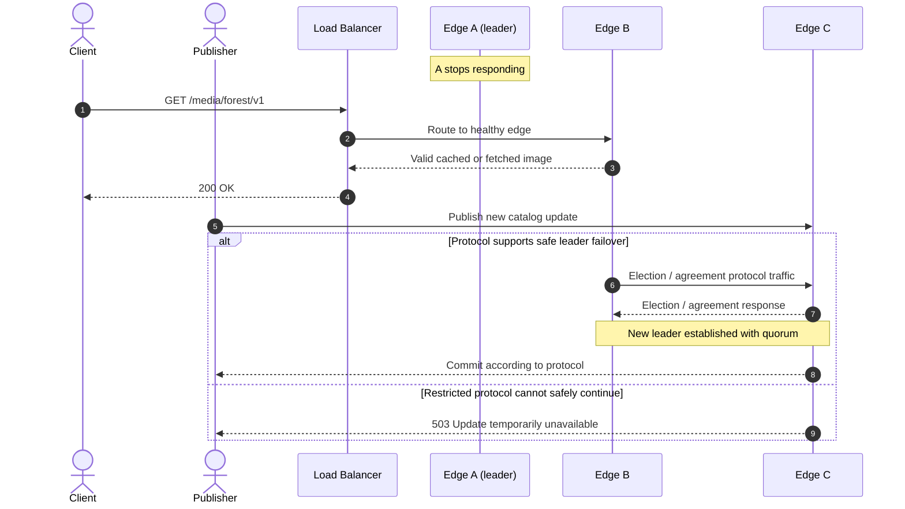
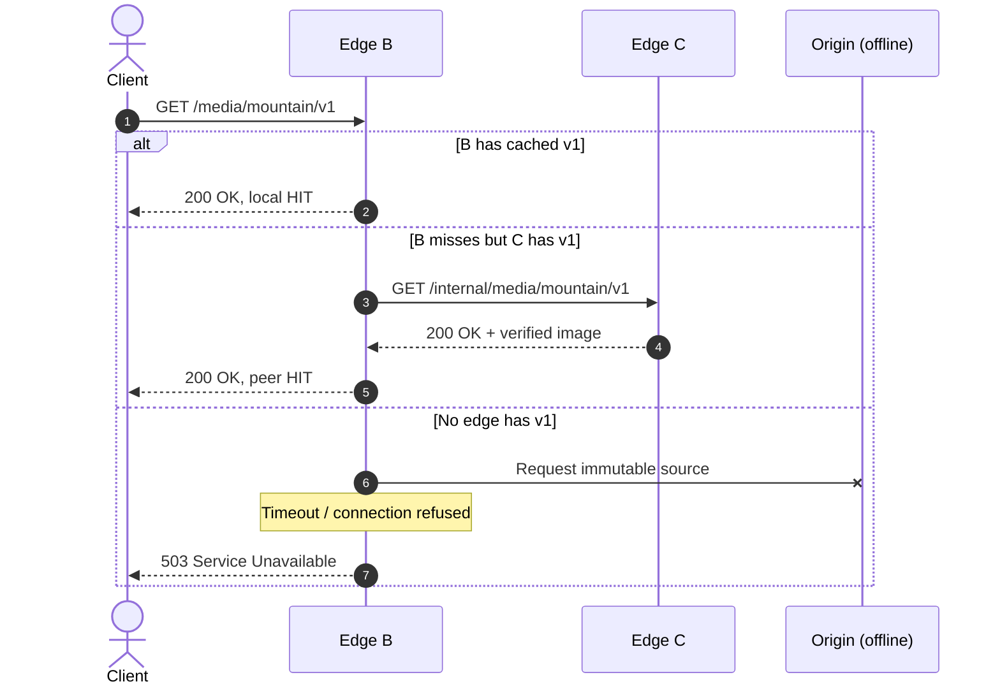

# Distributed CDN for an Image Gallery — Scope 1 Scenarios

**Document type:** Functional flows, edge cases, and sequence diagrams  
**Course:** Distributed Systems — Project 2026  
**Team:** Four students  
**Companion document:** `distributed_cdn_image_gallery_scope1.md`  
**Status:** Proposed test and demonstration specification; adjust to the protocol the team actually implements

> **Scope:** Image files only. Video playback, streaming, transcoding, and adaptive bitrate delivery are intentionally excluded. This document describes **system scenarios** and their expected outcomes, not the overall architecture or the detailed implementation plan.

## 1. How to use this document

Each scenario includes its purpose, preconditions, message flow, expected outcome, and relevant distributed-systems properties. The sequence diagrams use [Mermaid](https://mermaid.js.org/syntax/sequenceDiagram.html), which renders in GitHub Markdown.

**Priority labels:**

- **Core** — Target for the mandatory image-only prototype and final demonstration.
- **Recommended** — Strongly useful for correctness and evaluation, after core flows work.
- **Optional** — Implement only if time remains or the selected consensus library makes it straightforward.

### 1.1 Participants and assumptions

| Name | Responsibility |
|---|---|
| **Client** | Browser displaying the gallery; requests metadata and image bytes. |
| **LB** | Simple reverse proxy/load balancer; routes each HTTP request to one available edge. |
| **Edge A / B / C** | Independent CDN nodes on three distinct VMs, each with local cache, a content-catalog replica, and direct peer connectivity. |
| **Leader** | Temporary role held by one of the three edge nodes for replicated catalog operations; may change after election. |
| **Origin** | Host-side server storing immutable, versioned source images. Not a consensus participant. |
| **Publisher** | Administrative script that stages a new image at the origin and requests catalog publication. |

The diagrams assume that an image has a stable ID (e.g. `forest`) and immutable versioned URL (e.g. `/media/forest/v2`). The **content catalog** maps an image ID to its *current* version, title, content type, expected length, checksum, and origin key. The catalog is replicated; the image bytes in edge caches **are not required to be replicated everywhere**.

### 1.2 Fundamental correctness rules

1. An edge may serve `/media/forest/v2` only if it has **version 2** and the bytes match the expected checksum. An older version is not a substitute.
2. A publication must stage the complete, immutable image at the origin **before** committing a catalog update that advertises it.
3. Catalog changes become authoritative only according to the selected agreement protocol's **commit** rule. A proposal or a single acknowledgement is not a commit.
4. When a node receives an unknown or not-yet-applied catalog revision, it must not pretend that it is current. Read staleness and availability limitations must be documented.
5. All three edges must exchange direct peer messages with both other edges (e.g. readiness/status), even when a particular image request is served locally.
6. The prototype should not claim automatic leader failover, linearizable reads, durable recovery, or safe network-partition handling unless those properties are actually provided and tested by the chosen implementation.

### 1.3 Scenario index

| ID | Scenario | Priority | Main behavior |
|---|---|---|---|
| S01 | Open the image gallery | Core | Read shared catalog and request versioned media URLs |
| S02 | Local cache hit | Core | Serve an already-cached image without peer/origin traffic |
| S03 | Cache miss resolved from a peer | Core | Edge-to-edge image transfer and local caching |
| S04 | Cache miss resolved from origin | Core | Origin fallback when neither peer has the image |
| S05 | Publish a new image | Core | Stage bytes, agree on new catalog entry, expose it in gallery |
| S06 | Replace an image with a new version | Core | Coordinate version change; invalidate old *current* pointer lazily |
| S07 | Simultaneous conflicting publications | Recommended | Order or reject concurrent catalog changes consistently |
| S08 | Peer unavailable during retrieval | Recommended | Timeout, skip failed peer, and continue fallback path |
| S09 | Invalid or corrupted image bytes | Recommended | Reject checksum mismatch and retry another source |
| S10 | Edge failure / lost consensus leader | Optional | Distinguish read availability from write/leader availability |
| S11 | Origin unavailable | Optional | Serve existing cache hits; fail cleanly on uncached objects |
| S12 | Rejoining node with stale catalog | Optional | Catch up committed metadata after reconnect/restart |

---

## 2. Core scenarios

### S01 — Client opens the image gallery

**Priority:** Core  
**Purpose:** Show the gallery listing is generated from the replicated content catalog and that images have versioned URLs.

**Preconditions:** All edge nodes are running. The shared catalog contains several committed image entries. The load balancer is reachable.



**Expected outcome:** The browser displays the gallery using image URLs such as `/media/forest/v2`. The serving node may vary between requests. No particular edge is hardcoded as the permanent client destination.

**Important consistency note:** A catalog replica may lag behind a newly committed update. If the team implements local catalog reads, the gallery may briefly show an older revision. A stronger read guarantee requires an explicit safe-read mechanism supported by the chosen protocol; simply forwarding to a leader does not automatically make reads linearizable.

**Evidence to capture:** Which edge answered `/api/gallery`, its catalog revision, which edge served an image, and the image version.

### S02 — Local cache hit

**Priority:** Core  
**Purpose:** Demonstrate the primary CDN optimization: satisfy repeated requests locally.

**Preconditions:** Edge A has a valid cached copy of `forest/v2`; its catalog view identifies the expected metadata for v2.



**Expected outcome:** Edge A returns the exact requested image without contacting peers or origin for image bytes. `cache_hits` increments. The response identifies the serving edge and requested version in development-only headers or logs.

**Measurement:** Compare request duration with S03 and S04; a local hit is expected to involve less network traffic, though actual timings on collocated VMs may vary.

### S03 — Cache miss resolved through another edge

**Priority:** Core  
**Purpose:** Demonstrate direct edge-to-edge media exchange and cache population.

**Preconditions:** Edge B does **not** have `forest/v2`; Edge A has a valid cached v2; the catalog describes v2.



**Expected outcome:** B obtains the image from A, validates it, caches it, and returns it. A subsequent request directed to B becomes a local cache hit. The origin receives no image fetch in this scenario.

**Evidence to capture:** `peer_fetches`, the source peer ID, transferred bytes, checksum result, and cache entry created on B.

**Course connection:** The peer fetch is direct node-to-node communication; catalog replication and readiness/status traffic independently ensure every required node talks to both peers.

### S04 — Cache miss resolved through origin

**Priority:** Core  
**Purpose:** Demonstrate the complete fallback chain when no edge has the requested image.

**Preconditions:** A valid committed catalog entry identifies `city/v1`. Edge C has no copy, and its two peers also do not have v1. The origin has the staged immutable source object.



**Expected outcome:** Edge C retrieves from origin, validates and caches the image, and returns it. The next matching request to C should be a HIT. The peer requests are bounded by timeouts.

**Scope limit:** Peers do not have to maintain a distributed index of which caches hold which objects. Sequential peer queries are sufficient for three nodes.

### S05 — Publish a new image to the gallery

**Priority:** Core  
**Purpose:** Demonstrate that image bytes and authoritative catalog metadata are different concerns, and that a new catalog entry is agreed by the three nodes.

**Preconditions:** A publishing script can stage an immutable file at origin. An actual agreement implementation (or professor-approved restricted protocol) is configured on the three edges. Assume A is currently leader for illustration.

```mermaid
sequenceDiagram
    autonumber
    actor Publisher
    participant Origin
    participant B as Edge B (entry)
    participant A as Edge A (leader)
    participant C as Edge C

    Publisher->>Origin: Store immutable mountain/v1.jpg
    Origin-->>Publisher: Staged; size and SHA-256 available
    Publisher->>B: POST /admin/publish (mountain, v1, hash)
    B->>A: Forward proposed catalog operation
    A->>A: Validate proposal and expected version
    par Replicate to B
        A->>B: Replication / agreement messages
        B-->>A: Protocol response
    and Replicate to C
        A->>C: Replication / agreement messages
        C-->>A: Protocol response
    end
    Note over A,C: Selected protocol determines<br/>when operation is committed
    A->>A: Apply committed catalog entry
    A-->>B: Publication committed + revision
    B-->>Publisher: Success + committed revision
    Note over B,C: Replicas apply committed entry<br/>as they receive it
```

**Expected outcome:** `mountain` becomes an authoritative gallery entry **only after protocol commitment**. The publisher receives an explicit success/revision, and online nodes eventually apply that committed entry. Its image bytes are fetched lazily when the image is requested.

**Important:** The diagram abstracts the consensus algorithm. The team must replace the generic agreement messages with the actual library/protocol semantics in implementation documentation. It is **not** sufficient to implement a leader broadcast with arbitrary acknowledgements and call it Raft.

**Evidence to capture:** Origin object staged first, proposal ID, committed revision, leader identity, and catalog revisions on A/B/C after synchronization.

### S06 — Publish a newer version and invalidate the old current version

**Priority:** Core  
**Purpose:** Demonstrate synchronization/consistency without proactively copying every new image to every edge.

**Preconditions:** The catalog says `forest` current version is 1. A and B cache `forest/v1`. The publisher has a new image with version 2.



**Expected outcome:** The catalog's **current-version pointer** becomes v2. Edge B may still physically store v1, but it does not serve v1 in response to `/media/forest/v2`. The CDN downloads v2 only when needed.

**Consistency boundary:** This diagram assumes B has already applied revision R before its gallery read. Without a safe-read protocol, a lagging node may temporarily expose an earlier gallery revision. An explicit `/media/forest/v1` request can still return immutable v1 if historical versions are kept; this is separate from what the current gallery advertises.

**Evidence to capture:** Catalog revision changes, before/after gallery URLs, old and new cache keys, checksum of returned v2.

---

## 3. Recommended correctness and resilience scenarios

### S07 — Conflicting publications arrive concurrently

**Priority:** Recommended  
**Purpose:** Explain and test how conflicting catalog changes are ordered or rejected. This is a strong demonstration of the agreement mechanism.

**Preconditions:** `forest` is currently v1. Two publishers independently attempt a replacement based on expected version 1. A is the current leader.

```mermaid
sequenceDiagram
    autonumber
    actor P1 as Publisher 1
    actor P2 as Publisher 2
    participant B as Edge B
    participant C as Edge C
    participant A as Edge A (leader)

    P1->>B: Publish forest with expected_version=1
    P2->>C: Publish forest with expected_version=1
    B->>A: Forward proposal X
    C->>A: Forward proposal Y
    A->>A: Serialize proposals using agreed log
    A->>A: Validate X against current version 1
    Note over A: X commits a new version via protocol
    A-->>B: X committed
    B-->>P1: Success (new current version)
    A->>A: Validate Y against updated version
    A-->>C: Reject stale expected_version
    C-->>P2: 409 Conflict; retry against newer version
```

**Expected outcome:** The two requests do not independently create conflicting authoritative catalog versions. One is accepted first; the other is rejected or deliberately serialized as a subsequent version according to the team's stated rule.

**Implementation note:** If proposals can be received out of order, the leader must validate expected versions when the relevant operation is serialized/applied, not only when a request first arrives. Include the operation's unique ID to recognize retries.

**Evidence to capture:** Ordered committed log entries, accepted version, `409` response, final matching catalog state on the replicas.

### S08 — Peer is unreachable during cache retrieval

**Priority:** Recommended  
**Purpose:** Show that a normal content request need not fail solely because one peer is unavailable.

**Preconditions:** Edge B lacks `mountain/v1`. Edge A is unreachable. Edge C has a valid copy, or the origin can serve it.



**Expected outcome:** B skips the unreachable peer after a bounded timeout and proceeds to another source. The client gets the correct image if one is available. No fabricated content is returned.

**Separate concern:** A failed peer also affects metadata agreement, but caching fallback and consensus availability are different properties and should be evaluated separately.

### S09 — Peer or origin returns an invalid file

**Priority:** Recommended  
**Purpose:** Ensure that faulty or incomplete transfers do not poison the local cache or return incorrect content.

**Preconditions:** The catalog contains the expected SHA-256 for `city/v1`. A peer returns corrupted or truncated bytes. Another source is available.

```mermaid
sequenceDiagram
    autonumber
    actor Client
    participant B as Edge B
    participant A as Edge A
    participant Origin

    Client->>B: GET /media/city/v1
    B->>A: GET /internal/media/city/v1
    A-->>B: 200 OK + incorrect/truncated bytes
    B->>B: Compare byte length and SHA-256
    Note over B: Verification fails; discard bytes
    B->>Origin: GET immutable city/v1 source
    Origin-->>B: Valid v1 bytes
    B->>B: Verify, store atomically
    B-->>Client: 200 OK + verified image
```

**Expected outcome:** The invalid payload is discarded and logged. B does not cache or serve it. If all available sources fail verification, the request fails explicitly (for example `502 Bad Gateway` or `503 Service Unavailable`) rather than returning corrupt image bytes.

**Evidence to capture:** Mismatch event with expected/received checksum and source, fallback result, absence of corrupt cache entry.

---

## 4. Optional failure and recovery scenarios

These scenarios are valuable to discuss in the design report. Implement them only if the selected protocol and remaining project time justify it.

### S10 — An edge node or the consensus leader fails

**Priority:** Optional  
**Purpose:** Distinguish file-read availability, load-balancer routing, and catalog-write availability during failures.

**Preconditions:** A is the current metadata leader. B and C are reachable; cached or origin copies of requested images exist.



**Expected outcome:** Healthy caches may still serve images. Whether new catalog updates remain available depends on the agreement protocol. **Do not claim automatic re-election or two-of-three progress unless it is implemented and tested.**

**Load-balancer assumption:** The LB must be configured to avoid an unresponsive edge, or the client may receive an error on that attempt. If LB health-based routing is not implemented, state that limitation.

### S11 — Origin is unavailable

**Priority:** Optional  
**Purpose:** Explain what availability caching provides and what it does not.

**Preconditions:** The origin is offline. A request is sent to Edge B. Edge B either has a verified local copy or can retrieve one from another edge.



**Expected outcome:** Already-cached content can remain available without origin access. An uncached image that no peer possesses cannot be reconstructed by the CDN and must fail cleanly.

### S12 — Rejoining node has outdated catalog data

**Priority:** Optional  
**Purpose:** Describe the gap between basic in-memory synchronization and actual recovery after disconnection or restart.

**Preconditions:** Edge C has catalog revision R. While C is offline, A and B agree on newer committed entries (for example R+1 and R+2). C reconnects.

```mermaid
sequenceDiagram
    autonumber
    participant C as Edge C (rejoining)
    participant A as Edge A (leader)
    participant B as Edge B

    C->>A: Reconnect; report known log/catalog position R
    A-->>C: Missing committed log entries / snapshot
    C->>C: Validate and apply committed updates
    C-->>A: Acknowledge applied position R+2
    C->>B: Direct readiness/status message
    B-->>C: Peer status reply
    Note over C: Resume serving within documented read policy
```

**Expected outcome:** C catches up before claiming the latest catalog revision. If the prototype does not support persisted logs, snapshots, or catch-up, recovery must be described as **designed but not implemented**, not demonstrated as a property of the system.

---

## 5. Cross-cutting observations to record

Every node should log significant events locally. For each scenario, capture enough information to reconstruct which nodes communicated and which version was served or committed.

| Category | Suggested data |
|---|---|
| **Requests** | Timestamp, request ID, edge ID, path, response status, duration |
| **Cache** | `HIT`, `MISS`, `PEER`, `ORIGIN`; image ID/version; number of bytes |
| **Peer messages** | Source/destination node, message type, result/timeout |
| **Catalog** | Local catalog revision, operation ID, image ID, old/new version |
| **Agreement** | Current leader/term if available, proposal, committed position, applied position |
| **Integrity** | Expected and actual length/checksum, verification result |
| **Failures** | Unreachable peer, unavailable origin, errors, fallback destination |

### Suggested metrics

- **Cache hit ratio:** local cache hits divided by total image requests.
- **Image retrieval latency:** compare local hit, peer retrieval, and origin retrieval.
- **Origin fetch count:** number of image requests that reach the origin.
- **Metadata commit latency:** publication request until authoritative commit is confirmed.
- **Metadata application lag:** elapsed time between commit and a particular online replica applying the entry, if measurable.
- **Inter-node transferred bytes:** approximate content-transfer overhead for peer retrieval.

All numbers collected on VMs sharing a physical host are **local experimental measurements**, not evidence of real-world geographical CDN acceleration.

## 6. Minimal acceptance checklist

Use this as a stopping rule to prevent the image-only prototype from expanding unnecessarily.

- [ ] Three separate VM nodes each have their own IP address and directly exchange readiness/status messages with **both** peers.
- [ ] A browser can request and display the image gallery via one stable client entry URL.
- [ ] Each edge serves valid image bytes for an exact, immutable versioned URL.
- [ ] A local cache hit is distinguishable from a cache miss.
- [ ] An edge can retrieve a missed image from a peer and store the verified result.
- [ ] An edge can retrieve a missed image from the origin when peers lack it.
- [ ] An image can be staged at the origin and published through an **agreed** catalog operation.
- [ ] A newer image version updates the catalog's current-version pointer without confusing the older cached version with the newer one.
- [ ] Three nodes expose verifiable catalog revisions/committed state and relevant consensus logs or status.
- [ ] Important inter-node messages and requests are logged; at least basic latency and cache metrics are collected.
- [ ] The report states precise limits for stale reads, node failure, protocol guarantees, and unimplemented recovery behavior.

**Do not add videos or sophisticated gallery features until this image-only checklist is satisfied.**

## 7. Open decisions for the team

These choices must be finalized in the architecture and implementation documents, then reflected in expected outcomes here:

1. Which **consensus implementation** will be used, and what actual commit/failover guarantees does it provide?
2. Will `GET /api/gallery` use **local eventually updated replicas** or an explicit **safe current-read path**?
3. Which publication update rule is used for concurrent writes (for example `expected_version` plus `409 Conflict`)?
4. Which failures will be supported in the running prototype, and which will appear only as architectural discussion?
5. Will the LB perform backend health checks, or will failed-edge routing be acknowledged as a limitation?

---

**Design basis:** Companion Scope 1 architecture document and *Distributed Systems — Project 2026* course brief. The flows above are **proposed** behavior. They are not evidence that a particular implementation already provides these guarantees.
