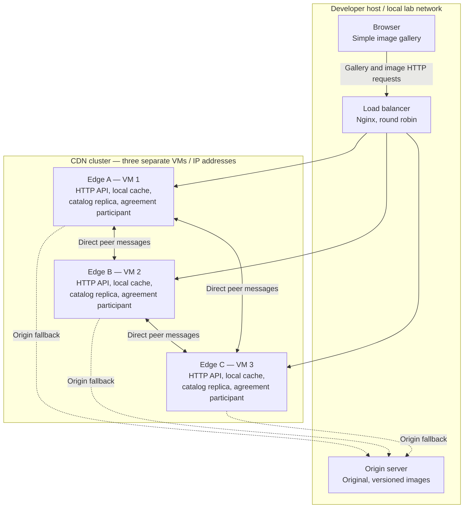
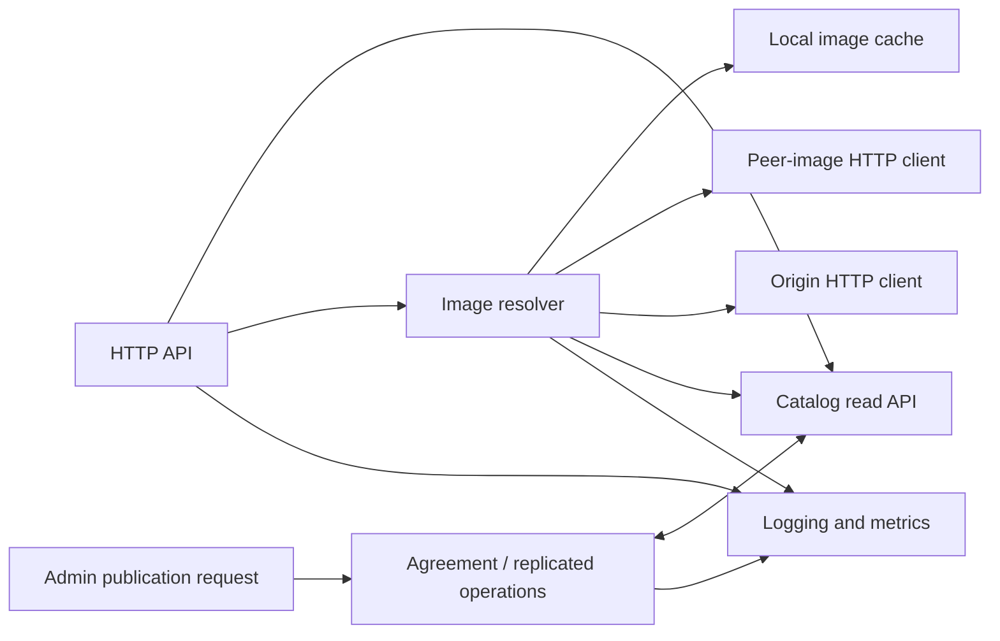
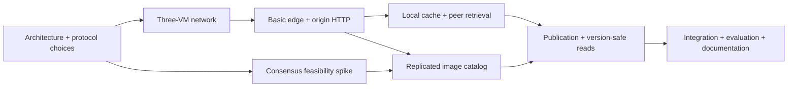

# Distributed CDN for an Image Gallery — Scope 1

**Document type:** Preliminary technical architecture and implementation plan  
**Course:** Distributed Systems, University of Helsinki (2026)  
**Team:** Four students  
**Project duration:** Approximately six weeks, including architecture and documentation; approximately four weeks available for implementation  
**Status:** Proposed design — subject to team decisions and course-staff feedback

> **Scope boundary:** This document specifies the **mandatory image-gallery prototype only**. Video uploads, playback, streaming, transcoding, and adaptive bitrate delivery are **out of scope**. The data model and architecture should be extensible to other media later, but no video functionality is required to finish Scope 1.

## 1. Project overview

The project is a **small distributed content delivery network (CDN)** that serves a public gallery of static images. Instead of serving every image directly from one origin server, three **edge nodes** can cache images locally, fetch missing content from peer nodes or the origin, and deliver images to clients.

The edge nodes also maintain a replicated **content catalog** (also called a *content manifest*): a small collection of records identifying available images, their current versions, and their checksums. When an image is added or replaced, the edge nodes coordinate the authoritative catalog update using a distributed agreement mechanism.

The principal deliverable is **not a feature-rich photo-sharing application**. It is a working demonstration of distributed communication, shared state, synchronization and consistency, and consensus using image delivery as the application domain.

### 1.1 Problem addressed

A single content server can become a bottleneck and a single point of failure, and repeatedly delivering the same files from the origin wastes network bandwidth. Multiple independent caches can reduce repeat origin requests and improve content availability. However, distributed caches introduce coordination problems: nodes may hold different files, have outdated versions, or temporarily disagree about the current catalog.

This project investigates how cooperating cache servers can **serve images efficiently while agreeing on authoritative image versions**.

### 1.2 Goals

- Serve a small public image gallery through multiple independent edge servers.
- Cache requested image files on the edge that serves the request.
- Obtain an uncached image from a peer edge, falling back to the origin when needed.
- Maintain and synchronize a replicated image catalog across the three edge nodes.
- Demonstrate an actual distributed agreement mechanism for catalog changes.
- Record node activity and collect simple measurements for evaluation.
- Describe how the architecture could scale beyond the three-node prototype.

### 1.3 Explicitly out of scope

- Video features of any kind (reserved for a later scope).
- Accounts, authentication, comments, likes, albums, image editing, and public uploads.
- Automatic thumbnail generation, image transformations, or content moderation.
- Global DNS routing, geographic placement, multiple data centers, Kubernetes, or production security infrastructure.
- Complex cache eviction algorithms, arbitrary cluster membership changes, and full crash/partition recovery guarantees unless time permits.

## 2. Prototype deployment architecture

Three independent Ubuntu virtual machines are the **three graded distributed nodes**. A load balancer, an origin server, and the browser are supporting components and **do not count toward the three-node minimum**.



### 2.1 Deployment decisions

| Component | Example location | Role |
|---|---|---|
| Edge A | VM 1, `192.168.56.11:8000` | CDN participant |
| Edge B | VM 2, `192.168.56.12:8000` | CDN participant |
| Edge C | VM 3, `192.168.56.13:8000` | CDN participant |
| Load balancer | Host, e.g. `192.168.56.1:8080` | Entry point for client requests |
| Origin server | Host, e.g. `192.168.56.1:9000` | Authoritative source of image bytes |
| Gallery client | Host browser | Displays gallery and requests images |

*All addresses are examples. Actual values depend on the VM network.*

Every edge node must have its **own IP address** and communicate **directly with both other edge nodes**. At minimum, each peer pair exchanges readiness/status messages; peer image transfer and agreement messages provide additional communication. A load balancer cannot substitute for this edge-to-edge connectivity.

The three VMs may run on one physical computer. The project must **not** be implemented as three containers sharing only one machine without separate VMs. Nginx and the origin can run as ordinary host processes to avoid unnecessary infrastructure work.

## 3. Component responsibilities

### 3.1 Edge nodes A, B, and C — identical software

Each node provides the same functions:

1. **HTTP serving:** Receive image and gallery-metadata requests and return responses.
2. **Local image cache:** Store and retrieve immutable image versions on local disk.
3. **Cache-miss resolution:** Request the required version from peers, then the origin if needed.
4. **Catalog replica:** Maintain the accepted set of image metadata records.
5. **Distributed coordination:** Participate in agreement on catalog publication operations; a leader/coordinator is a *temporary role*, not a permanently different machine.
6. **Peer communication and readiness:** Exchange messages with both peer nodes and report local status.
7. **Logging and measurements:** Log important operations and count cache hits, misses, peer fetches, origin fetches, and selected latencies.

**Caches may differ between nodes.** The authoritative *catalog state* is what needs agreement; an image does not have to be proactively copied to every cache.

### 3.2 Origin server

- Stores the original image bytes, preferably as **immutable versioned objects**.
- Exposes HTTP access for edge nodes to retrieve an exact image version.
- Makes new image bytes fully available **before** the corresponding catalog entry is published.
- Does **not** participate in the three-node consensus group.

For Scope 1, an administrative script can place files in the origin directory. There is no need to implement a public upload interface.

### 3.3 Load balancer

- Provides a single URL for the browser.
- Forwards requests to Edge A, B, or C using a basic policy such as round robin.
- May use simple upstream health checks if supported by the selected configuration.
- Does **not** decide authoritative image versions or run the agreement protocol.

### 3.4 Gallery client

- A minimal HTML/CSS/JavaScript page displays a grid of images and optional titles.
- Retrieves the gallery catalog and versioned image URLs through the load balancer.
- Has no knowledge of which edge physically stores an image.
- Does not count as one of the three required distributed nodes.

## 4. Logical software architecture

Each edge application can be divided into the modules below. These are **logical components inside one service**, not separate processes or extra VMs.



### 4.1 Image catalog (shared distributed state)

The catalog describes which images are published and which version is current. Example entry:

```json
{
  "id": "forest",
  "title": "Forest",
  "version": 2,
  "content_type": "image/jpeg",
  "size_bytes": 245000,
  "sha256": "<sha256-of-original-file>",
  "origin_key": "forest/v2.jpg"
}
```

The catalog contains **metadata, not image bytes**. It does not need to track the contents of every individual edge cache. On a miss, a node can ask its peers for the exact immutable version before contacting the origin.

### 4.2 Cache and retrieval policy

For a requested image version, the edge checks its local cache first. On a miss, it attempts direct peer retrieval with bounded timeouts, then falls back to the origin. A retrieved file is verified against the catalog's checksum before being cached and returned.

**Default prototype policy:** `local cache → peer A/B → origin`.

Images are stored under immutable keys such as `forest/v2.jpg`. Publishing `forest/v3.jpg` does not overwrite `forest/v2.jpg`; the catalog's current-version pointer changes instead. Old cached versions may remain until manually deleted or a future eviction mechanism is added.

### 4.3 Agreement and consistency

**Agreement target:** the authoritative, ordered sequence of catalog operations, such as `ADD_IMAGE` and `PUBLISH_NEW_VERSION`.

Recommended design:

- Use a **fixed group of three** agreement participants (the edges).
- Choose a leader-based replicated-operation protocol, preferably a supported **Raft implementation if permitted by course staff**.
- Apply catalog changes only after the protocol marks them committed.
- Keep each node's catalog synchronized from the same committed operation sequence.
- Restrict admin publication to the current leader or forward the request to it.

**Important:** A single leader that broadcasts updates is not, by itself, a correct consensus protocol. Majority acknowledgement without careful term, log, and recovery rules is also insufficient for general failure-tolerant consensus. If a library is not permitted, the team must agree with the teaching staff on the exact guarantees and limitations of an educational protocol before implementing it.

**Read rule for Scope 1:** A gallery listing should be served using a known-current catalog view (for example, by routing/forwarding authoritative catalog reads to the leader, using whatever read-safety mechanism the selected protocol supports). Immutable versioned image URLs can then be served by any edge. Do not claim that arbitrary reads from a stale replica always see the latest publication.

### 4.4 Data-plane and control-plane separation

| Plane | Operations | Requires consensus? |
|---|---|---|
| **Data plane** | Serve cached images; fetch from peers/origin; cache bytes | **No**: exact version + checksum are sufficient |
| **Control plane** | Publish image metadata; change current version; agree on ordered updates | **Yes**, under the chosen protocol |
| **Observability** | Heartbeats, readiness, logs, hit/miss counters | Usually **no** |

This keeps ordinary image reads fast and prevents each cache hit from triggering a three-node agreement round.

## 5. Proposed interfaces and messages

Final endpoint names can change. Keep the interface small and stable once implementation starts.

| Interface | Purpose | Caller |
|---|---|---|
| `GET /` | Serve the minimal gallery page | Browser |
| `GET /api/gallery` | Return published images and versioned URLs | Browser |
| `GET /media/{id}/v{version}` | Return an exact image version | Browser via load balancer |
| `POST /admin/publish` | Request a catalog add/version change | Administrative script |
| `GET /internal/media/{id}/v{version}` | Retrieve cached image bytes from a peer | Another edge |
| `GET /internal/status` | Report identity and readiness; support peer status exchange | Another edge |
| `GET /admin/status` | Display node, leader, catalog revision and peers | Developers |
| `GET /admin/metrics` | Expose counters and simple timings | Developers / evaluation scripts |

The chosen agreement library or protocol will have its **own internal messages** (for example, election, log replication, and commit-related messages). These must be documented after the actual implementation is selected. Do not invent an incompatible custom RPC format if the library manages transport itself.

## 6. Requirements traceability

The course brief asks for a **large-scale design**, but the **prototype** must run on at least three distinct IP-addressed VMs/computers and demonstrate shared distributed state, synchronization/consistency, and consensus. All nodes must log important events.

| Course criterion | Evidence from Scope 1 |
|---|---|
| Three separate participant nodes | Edge A, B, and C on three VMs/IPs |
| Each node communicates with two other nodes | Full peer-to-peer status/communication links, plus file transfer and coordination |
| Shared distributed state | Replicated image catalog and committed operation history |
| Synchronization and consistency | Propagation/application of committed catalog operations; version/checksum validation |
| Consensus | Leader election and agreement on catalog publication operations via selected protocol |
| Fault tolerance | Design explanation; limited node-failure behavior and documented limits in prototype |
| Scalability | Explain regional edge caching and separated coordination groups in the report; no large cluster required in prototype |
| Logging | Important events logged independently at every edge |
| Performance | Cache hit ratio, local/peer/origin retrieval latency, catalog commit latency and origin-request count |

**Specific limits to document:** stale metadata reads, unavailable peers/origin, overlapping publications, timeouts, leader loss, partial file transfer and process restart. Their detailed test cases belong in a **separate scenarios/test-plan document**.

## 7. Implementation choices

| Area                    | Proposed choice                                                       | Reason                                                  |
| ----------------------- | --------------------------------------------------------------------- | ------------------------------------------------------- |
| Language                | Python 3 on all three edges                                           | Fast development, familiar HTTP/file tooling            |
| Edge API                | FastAPI + Uvicorn                                                     | Small and inspectable HTTP service                      |
| Peer/origin HTTP client | `httpx`                                                               | Straightforward asynchronous network calls and timeouts |
| Load balancing          | Nginx on host                                                         | Avoid building a custom balancer                        |
| Image storage           | Filesystem directories per VM                                         | Minimal operational overhead                            |
| Catalog                 | In-memory state backed by the selected replicated operation mechanism | Avoid adding a separate distributed database            |
| Image verification      | SHA-256 via `hashlib`                                                 | Detect wrong/incomplete file versions                   |
| Logging                 | Python `logging`                                                      | Trace node operations and errors                        |
| Automated tests         | `pytest` + shell/HTTP scripts                                         | Repeatable integration and performance checks           |
| Deployment              | 3 Ubuntu VMs on an isolated virtual network                           | Satisfies the distinct-node requirement                 |

No Docker, Kubernetes, Redis, Kafka, cloud object storage, or frontend framework is required for Scope 1.

### 7.1 Decisions the team must confirm early

1. **Consensus implementation:** Existing Raft library (subject to teacher approval) or a clearly restricted educational protocol. This is the highest-risk dependency.
2. **Read consistency:** How `GET /api/gallery` obtains a current-enough catalog view, particularly during elections or failures.
3. **Publication workflow:** How new file bytes are placed at the origin before metadata commitment.
4. **Origin availability assumptions:** Whether content reads are allowed to fail when both peers and origin lack the requested version.
5. **Persistence:** Which state survives a process restart and which recovery claims the prototype can support.

## 8. Ownership: four team members

Responsibilities should be clear, but **all four members participate in architecture, integration reviews, testing and the final report**. The consensus component is not a one-person responsibility in practice.

| Member                                       | Primary ownership                                                                                  | Key deliverables                                                           |
| -------------------------------------------- | -------------------------------------------------------------------------------------------------- | -------------------------------------------------------------------------- |
| **Member 1 — Infrastructure and networking** | Three-VM setup, IP/network configuration, Nginx, origin server, peer connectivity                  | Repeatable launch scripts, origin file serving, working VM network         |
| **Member 2 — CDN data plane**                | Local image cache, peer retrieval, origin fallback, checksum validation                            | `/media/…` and `/internal/media/…`, local cache, cache hit/miss logic      |
| **Member 3 — Distributed control plane**     | Catalog state model, publication ordering, consensus integration, catalog synchronization          | Replicated manifest and safe publication protocol                          |
| **Member 4 — Application and evaluation**    | Minimal gallery frontend, read/admin API integration, logging/metrics aggregation, automated tests | Gallery page, status/metrics inspection, integration and performance tests |

**Pairing rule:** Member 1 supports Member 3 with transport/deployment and early consensus integration; Member 2 works with Member 3 on cache-versus-catalog version checks. Member 4 develops integration tests as soon as the first API endpoints are available.

Each member should document their own contributions, design decisions, and course-relevant use of AI, as required by the course brief.

## 9. Development sequence and dependencies

**Constraint:** ~2 weeks for topic/architecture/design and ~4 weeks for implementation, integration and deliverables. The initial agreement-protocol feasibility check must start early, even if complete integration happens later.

| Period                           | Main activity                                                                                                         | Completion gate                                                    |
| -------------------------------- | --------------------------------------------------------------------------------------------------------------------- | ------------------------------------------------------------------ |
| **Week 1 — Architecture**        | Confirm MVP, draw deployment, define catalog fields, agree on consistency model and protocol strategy                 | Architecture and message/interface definitions approved by team    |
| **Week 2 — Design + risk spike** | Prepare design plan; set up 3 VMs; verify all-to-all communication; test a minimal three-node agreement setup/library | VMs communicate; consensus approach judged feasible                |
| **Week 3 — Data plane**          | Origin file hosting, minimal gallery endpoints, local caching, peer and origin fetches                                | Images can be retrieved via any edge; cache hits/misses observable |
| **Week 4 — Control plane**       | Integrate replicated catalog, leader/coordinator handling and publication operations                                  | Nodes agree on a catalog update and expose the accepted version    |
| **Week 5 — Integration**         | Complete version validation, client/load-balancer integration, logging, bounded timeouts, limited failure handling    | Full image-only CDN works end-to-end on 3 VMs                      |
| **Week 6 — Stabilize + submit**  | Regression tests, measurements, documentation, demo recording/live-demo preparation                                   | Reproducible setup, credible evaluation, finished deliverables     |

### 9.1 Dependency order



**Scope-control rule:** If the agreement layer is behind schedule, remove nonessential gallery polish and optional cache features; do not cut the required distributed-state, synchronization or consensus functionality merely to finish the UI.

## 10. Evaluation and documentation

The separate test-plan document should define the detailed demonstrations and expected outcomes. This architecture document only identifies the principal areas to evaluate:

- Correctness of cache hits, peer/origin fallback, and version/checksum validation.
- Agreement on catalog publications and consistency of the resulting state.
- Direct communication among all three nodes and each node's reported status.
- Behavior under selected edge cases and the actual limitations of failure handling.
- Performance metrics: hit ratio, local-versus-remote retrieval latency, number of origin fetches, and catalog commit/propagation latency.

Because all three VMs may share one physical host, measured latencies **do not represent real geographical CDN performance**. They are suitable for controlled, comparative measurements of this implementation.

The final report should explain the large-scale design separately: many edge caches, regional routing, replication groups or coordination services, content partitioning, and the network/performance consequences of scaling. Scope 1 does **not** implement those features.

## 11. Future extension — not part of Scope 1

The underlying data model can later add `media_type`, `content_type`, and object size fields for video files without changing the basic idea of immutable versioned media objects. **Serving small MP4 files** would be a possible separate extension. Efficient video seeking, HTTP range support, video transcoding, HLS, and adaptive streaming are **not required or planned for Scope 1**.

---

**Basis:** *Distributed Systems — Project 2026* course brief, especially the three-node/network requirements, shared state/consistency/consensus criteria, deliverables, and emphasis on large-scale architectural design versus a small working prototype. This document contains a proposed implementation design; technology and algorithm choices are recommendations for the team to review rather than requirements imposed by the course.
