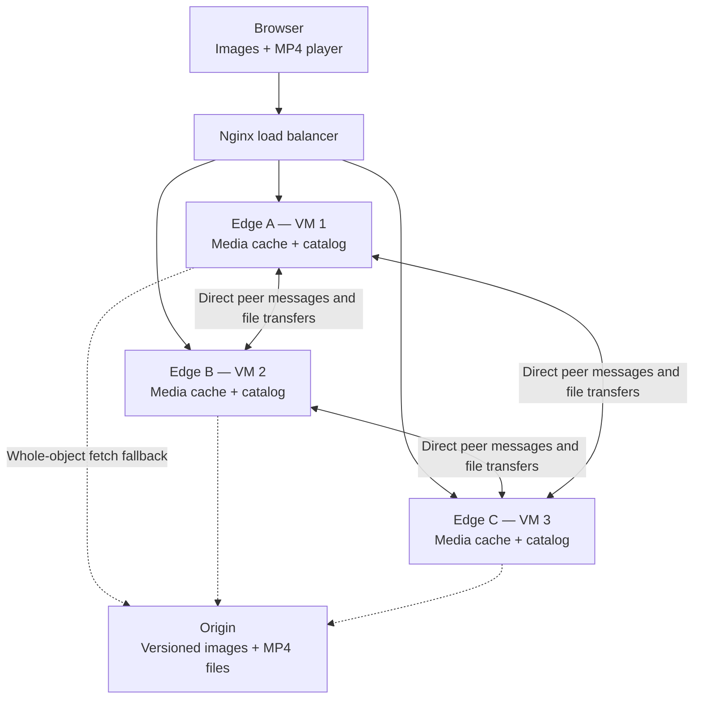
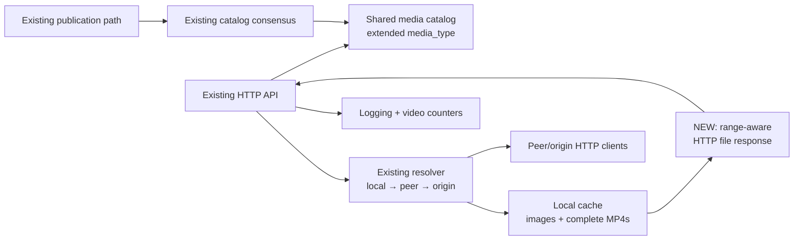
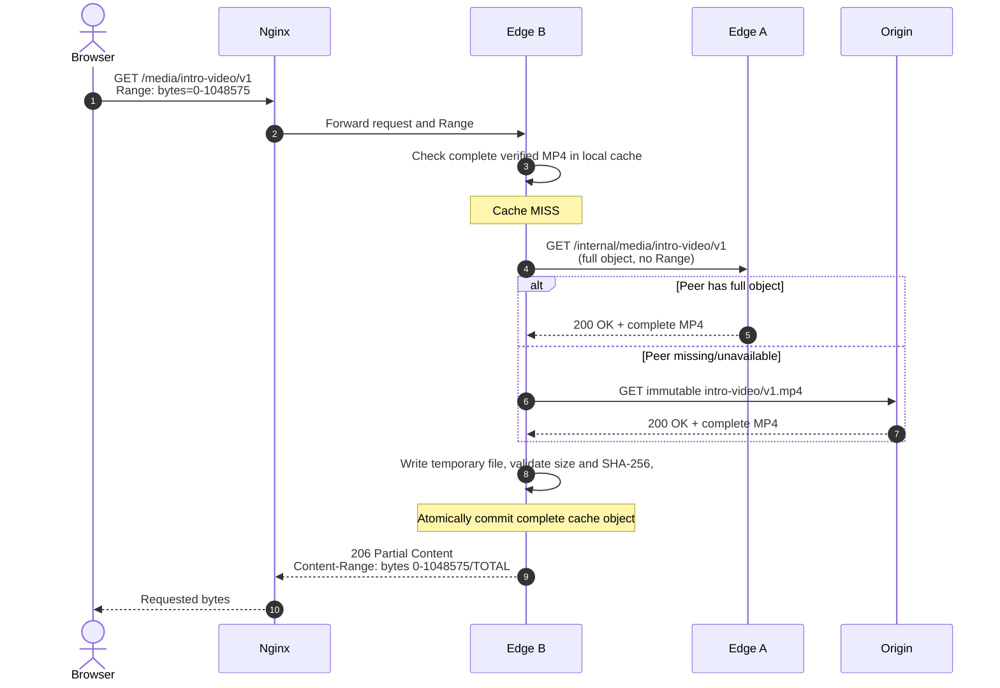

# Distributed CDN Media Gallery — Scope 2: Basic Video Support

**Document type:** Optional extension architecture and implementation plan  
**Course:** Distributed Systems, University of Helsinki (2026)  
**Team:** Four students  
**Depends on:** [`distributed_cdn_image_gallery_scope1.md`](distributed_cdn_image_gallery_scope1.md)  
**Status:** Proposed optional extension — **Scope 1 remains the mandatory deliverable**

> **Scope boundary:** Scope 2 extends the working image CDN to serve **small, pre-encoded MP4 videos in the same gallery**. The goal is **basic browser playback with seeking using HTTP byte ranges**, while retaining Scope 1's three-node caching, versioning, and metadata agreement. This is **not** a video streaming platform: no transcoding, HLS/DASH, adaptive bitrate, live video, or distributed segment caching.

## 1. Purpose and prerequisites

Scope 1 already provides a three-edge CDN with a browser gallery, a load balancer, an origin server, local caches, peer/origin retrieval, an agreed replicated content catalog, versioned URLs, and logging. Scope 2 tests whether the **same infrastructure can deliver a different, larger media object** without redesigning the distributed control plane.

**Problem addressed:** Videos are larger than photographs. A browser may request only a portion of a video to begin playback or seek to another timestamp. The CDN should be able to deliver videos from local cache or retrieve them from peers/origin, and return appropriate HTTP responses so a browser can play them.

**Entry criterion:** Do not begin Scope 2 until Scope 1's required three-node communication, catalog agreement, image retrieval, and image-version publication work reliably and have repeatable tests. Scope 2 must not endanger the mandatory submission.

### 1.1 Goals

- Include **2–3 short, pre-encoded MP4 files** in the existing gallery alongside images.
- Continue using the existing **single URL**, load balancer, three edge nodes, origin, catalog, and consensus mechanism.
- Reuse the **same immutable versioned media path**, e.g., `/media/intro-video/v1`.
- Support browser `<video>` playback and **single-byte-range** requests for basic seeking, without downloading the full file *on each request*.
- Cache a **complete, checksum-verified** MP4 at an edge; reuse it for subsequent full or partial requests.
- Report basic video cache and transfer metrics without introducing a new distributed subsystem.

### 1.2 Out of scope for Scope 2

- HLS, MPEG-DASH, adaptive bitrate streaming, live streaming, playlists, segment generation or segment-level caching.
- Transcoding, video resizing, codecs negotiation, server-generated posters/thumbnails, public uploads or user accounts.
- Caching **incomplete byte ranges**, stitching partial downloads together, concurrent chunk downloads, resumable origin transfers, or cache eviction based on video size.
- Replicating entire videos proactively to all edge nodes, or adding a dedicated video metadata-consensus group.
- Production-grade security, cross-region routing, object storage and automated horizontal scaling (design-only ideas for a later scope).

## 2. What changes compared with Scope 1?

**Core architectural decision:** Treat videos as another kind of **immutable versioned media object**. Metadata and consensus remain nearly identical; the significant additions are **browser playback**, correct **HTTP byte-range responses**, and a carefully bounded **whole-object caching policy**.

| Component / concern | Scope 1 | Scope 2 addition or change |
|---|---|---|
| Three edge VMs | Cache and serve images | **Reuse as-is**; also store and serve MP4 objects |
| Load balancer | Round-robin HTTP reverse proxy | **Reuse**; verify it forwards `Range` requests and `206` responses correctly |
| Origin server | Stores immutable versioned images | **Extend** file store and HTTP serving to versioned `.mp4`; support full-object fetches |
| Replicated catalog | Image ID, version, MIME type, length, hash, origin key | **Add** `media_type: image \| video`; optionally a poster image reference and video duration |
| Agreement/consensus | Orders image publication updates | **Reuse unchanged** for video publication; no agreement on playback requests |
| Cache resolver | Local → peer → origin | **Reuse**; fetch entire MP4 on a miss, verify, then cache atomically |
| Client response | Serve images with a full HTTP response | **Extend** to support full `200` and single-range `206` video responses |
| Gallery frontend | Image grid | **Extend** to distinguish images/videos and show `<video controls>` for videos |
| Logging and metrics | Hits, misses, origin/peer transfers | **Add** media type, bytes, cache source, range-response counts and timing |
| Test automation | Image and catalog tests | **Add** playback, valid/invalid ranges, cached video and metadata regression tests |

No additional VM, coordinator, load-balancing protocol or consensus algorithm is required.

## 3. Updated deployment and logical architecture

### 3.1 Deployment topology — unchanged



The three edges remain the **only three required distributed participant nodes**; each VM has its own IP address and communicates directly with both peers. The browser, Nginx and origin remain auxiliary components. This arrangement continues to satisfy the course's node topology requirement.

### 3.2 Edge-node modules — minimal changes



**Important distinction:** The **catalog** is replicated and ordered by consensus. The **video bytes in caches** are not globally replicated and do not require consensus on each request. An edge can independently cache or evict a media object without changing the authoritative catalog.

## 4. Data model and storage extensions

### 4.1 Generalize the existing catalog entry

Scope 1's fields (`id`, `title`, `version`, `content_type`, `size_bytes`, `sha256`, `origin_key`) continue to apply. Add a discriminator so that the gallery knows which viewer to render.

```json
{
  "id": "intro-video",
  "title": "Gallery Introduction",
  "version": 1,
  "media_type": "video",
  "content_type": "video/mp4",
  "size_bytes": 12582912,
  "sha256": "<sha256-of-complete-mp4>",
  "origin_key": "intro-video/v1.mp4",
  "poster_image_id": "intro-poster"
}
```

- **`media_type`**: `image` or `video`; existing Scope 1 image entries can default to `image` for backward compatibility.
- **`content_type`**: existing MIME type field; use `video/mp4` for MP4s.
- **`size_bytes` and `sha256`**: already defined in Scope 1; verify the **complete** file after a cache miss.
- **`poster_image_id`**: optional link to an image already in the gallery; no thumbnail generation.
- **`duration_seconds`**: optional display-only metadata, not needed for correct delivery.

**Versioning remains immutable.** Publishing a changed video creates a new origin object, e.g., `intro-video/v2.mp4`, and then commits an updated catalog record. Never overwrite a published version in place. The catalog decides the current version; cached older versions may remain on disk.

### 4.2 Filesystem layout

```text
origin/
  forest/v2.jpg               # Scope 1
  intro-video/v1.mp4          # Scope 2
  intro-poster/v1.jpg         # Optional poster stored as ordinary image

edge-a/cache/
  forest/v2.jpg
  intro-video/v1.mp4          # Only if this node fetched it
```

Do not create a separate video database or video metadata service.

## 5. HTTP delivery and byte ranges

### 5.1 Why ranges matter

A browser video player may send `Range: bytes=...` to request a portion of a file, including when the user seeks. HTTP defines `206 Partial Content` for a successful range response, `Content-Range` for the returned interval, and `416 Range Not Satisfiable` for unsatisfiable ranges. The appropriate behavior is described in [RFC 9110, §14](https://www.rfc-editor.org/rfc/rfc9110.html#section-14).

**Target contract for an already-cached MP4:**

| Incoming request | Expected response | Explanation |
|---|---|---|
| `GET /media/intro-video/v1` | `200 OK` | Full MP4, `Content-Type: video/mp4`, correct `Content-Length` |
| `GET ...` with `Range: bytes=0-1048575` | `206 Partial Content` | First 1 MiB (or a smaller returned satisfiable range), with `Content-Range` and correct partial length |
| `GET ...` with a later valid range | `206 Partial Content` | Serves bytes from the cached complete file without new upstream fetch |
| `GET ...` with an unsatisfiable range | `416 Range Not Satisfiable` | Include `Content-Range: bytes */<total-size>` when appropriate |

Where ranges are supported, advertise `Accept-Ranges: bytes`. For a single-range response, `Content-Range` has the form `bytes START-END/TOTAL`, with an **inclusive** end index. For instance, a 12 MiB file requested as `bytes=0-1048575` returns 1,048,576 bytes and `Content-Range: bytes 0-1048575/12582912`.

**Do not attempt to construct `206` responses by simply copying headers from a full upstream `200` response.** Use a range-capable file response library and test its actual status, body size, and headers.

### 5.2 Implementation choice

Scope 1 already proposes Python, FastAPI and local filesystem caching. FastAPI is built on Starlette; current [Starlette `FileResponse`](https://www.starlette.dev/responses/#fileresponse) documents byte-range support, including `206` and `416`. Use a compatible installed version and verify behavior in an integration test instead of writing byte-slicing code from scratch.

Suggested strategy:

1. Resolve the requested **exact immutable version** using the existing catalog.
2. If a **complete, verified** video file exists in the edge cache, return a file response. Let the HTTP library handle `Range`.
3. If absent, perform a **full-object fetch** from a peer or origin, without forwarding the browser's `Range` as a partial-cache request.
4. Stream the upstream object to a **temporary file**; enforce a maximum supported size; compare total length and SHA-256 with the committed catalog entry.
5. Atomically rename the verified file into the cache and return the requested full response or range.
6. If fetching or verification fails, discard the temporary file and return an error; do not cache or serve incomplete bytes as valid content.

This policy deliberately avoids caching partial MP4s. It is easy to reason about, reuses Scope 1's checksum guarantees, and is suitable for **small videos**.

**Tradeoff:** On a cold miss, the browser may wait until the **entire MP4** has been fetched and verified before playback or seeking begins. This is a known limitation of the optional extension. Choose short/small clips, or pre-warm one edge's cache through an ordinary full-file request during setup. Do not claim low startup latency for cold large files.

### 5.3 Full-object miss followed by range delivery



The sequence illustrates the **new media-transfer behavior**, not a new consensus step. A committed catalog entry is assumed to exist before the request. Peer and origin reads must target the **exact version**, and peer responses must provide full bytes for this implementation's cache-fill path.

### 5.4 Nginx and browser concerns

- Keep the original single gallery URL; the browser need not know which edge serves the video.
- Verify that `Range` reaches the selected edge and the response's `206`, `Content-Range` and `Content-Length` reach the browser unchanged.
- Keep Nginx's **own proxy caching disabled** in the prototype; caching should occur in your edge nodes so measurements are attributable to your system.
- Use an ordinary `<video controls preload="metadata">` element. `preload` is a browser hint, not a guarantee. See [MDN's `<video>` documentation](https://developer.mozilla.org/en-US/docs/Web/HTML/Reference/Elements/video).
- Use small, browser-compatible MP4 files (typically H.264 video and AAC audio, or silent H.264) prepared **offline**. No transcoding service is built.
- Prefer MP4 files prepared for progressive download (metadata placed near the beginning), using an offline preparation tool if necessary. This is an asset requirement, not a new server feature.

## 6. Minimal API changes

Retain the Scope 1 endpoints and use the same path for images and videos:

| Existing endpoint | Scope 2 treatment |
|---|---|
| `GET /api/gallery` | Return both image and video entries, distinguishable by `media_type` |
| `GET /media/{id}/v{version}` | Serve `image/jpeg`, `image/png` or `video/mp4`; for videos, support full and range responses |
| `GET /internal/media/{id}/v{version}` | Continue to support peer **full-object fetch**; optionally reject or ignore partial peer requests according to a documented policy |
| `POST /admin/publish` | Accept staged video metadata using the **same existing agreement path** |
| `GET /admin/status` / `/admin/metrics` | Add video entries and measurement counters where useful |

No separate `/video/*` service is required. Since the existing endpoint path is media-neutral, the backend can branch by catalog `content_type` or `media_type`.

### 6.1 Gallery client change

A simple browser rendering rule is sufficient:

```html
<!-- Image entry: Scope 1 -->


<!-- Video entry: Scope 2 -->
<video controls preload="metadata" poster="/media/intro-poster/v1">
  <source src="/media/intro-video/v1" type="video/mp4" />
</video>
```

A poster is optional and should reuse a normal Scope 1 image. In the actual UI, only load videos when the user chooses to play them, rather than automatically downloading every MP4 when opening the gallery.

## 7. Distributed-systems properties: what stays the same?

| Course criterion | Scope 2 effect |
|---|---|
| Three independent participant nodes | **Unchanged:** the same Edge A/B/C VMs |
| Each node communicates with two others | **Unchanged:** peer status, metadata replication, and file exchange |
| Shared distributed state | **Extended catalog:** image and video entries follow the same state model |
| Synchronization/consistency | **Unchanged mechanism:** catalog updates are synchronized; edge caches can differ |
| Consensus | **Unchanged mechanism:** video publication is ordered like image publication |
| Fault tolerance | **Same limitations:** cached complete videos remain locally servable; uncached videos need a reachable peer/origin; catalog writes follow the chosen consensus guarantees |
| Scalability | **Design discussion:** large files make cache capacity, network transfer, request routing, and eviction more important |
| Logging and performance | **Extend measurements:** bytes served, full/range requests, cold/warm video retrieval times |

**No consensus is needed to serve an already-published video or to decide which edge has it cached.** Consensus applies to authoritative catalog publications. Do not add a new election or quorum round for every playback or seek.

## 8. Video-specific implementation risks and limits

| Risk or edge condition | Scope 2 policy |
|---|---|
| Browser requests an uncached video range | Download **full** MP4 first; validate and cache; then answer the range. Cold start may be slow. |
| Two clients request the same uncached video concurrently | Prefer a **per-object local lock/in-flight task** to avoid duplicate upstream downloads; otherwise document the inefficiency. |
| Peer disconnects mid-transfer | Discard partial temp file and retry a different source if the deadline/timeout permits. |
| Video bytes differ from catalog checksum | Do not publish into local cache; log integrity failure and fail or try a different source. |
| Client seeks near the end of a cached video | Serve that valid byte interval as `206` using the locally cached complete object. |
| Browser requests an invalid range | Return standards-compliant behavior; test `416` for a clearly unsatisfiable range. |
| One edge is down | Load balancer may route to another active edge; playback depends on complete local copy or reachable origin/peer. |
| Video is larger than supported limit | Reject or exclude it from the optional gallery; set and document a small fixed cap (e.g. 20–30 MiB). |
| The origin is unavailable | A warm edge can still serve a complete cached video; a cold edge can try peers or fail clearly. |
| A new version is published | Publish a new immutable key and commit the new catalog pointer; old cached version remains separate. |

**Deployment note:** reverse-proxy timeouts and request-body/response buffering settings may affect cold video fetches. Configure and test for short files only; do not add general-purpose buffering infrastructure.

## 9. Recommended implementation sequence — only after Scope 1

Scope 2 should be treated as a **small follow-on increment**, not an independent workstream that competes with essential image/consensus functionality.


| Step | Change | Done when |
|---|---|---|
| **0. Gate** | Confirm image delivery, peer fetching, catalog agreement and logging remain stable | Scope 1 regression tests pass on three VMs |
| **1. Prepare content** | Add 2–3 pre-encoded small MP4s and optional poster images; extend catalog schema | Catalog and existing image entries remain valid |
| **2. Reuse full-object retrieval** | Ensure peer and origin paths can transfer MP4 files to temp storage | Edge obtains a complete MP4 from peer/origin |
| **3. Verify and cache** | Validate size/SHA-256 and rename atomically | Subsequent requests use complete cached MP4 |
| **4. Add range responses** | Enable or verify `FileResponse` byte ranges through edge and Nginx | Full request returns `200`; valid range returns `206`; invalid range tested |
| **5. Extend frontend** | Display video cards and `<video>` player | Playback works through shared CDN URL |
| **6. Regression/evaluation** | Compare cold vs warm video fetch, range response, bytes transferred and image regressions | Video and image behavior both remain correct |

**Recommended stop rule:** If Range support, MP4 compatibility or proxy behavior takes longer than expected, remove video from the final implemented scope; Scope 1 already meets the principal course criteria. Do not spend submission time on adaptive streaming.

## 10. Ownership by the same four members

Build on the Scope 1 ownership assignments rather than redistributing the entire project.

| Member | Existing Scope 1 ownership | Additional Scope 2 work |
|---|---|---|
| **Member 1 — Infrastructure and networking** | VMs, Nginx, origin, connectivity | Add MP4s to origin; confirm proxy Range/206 behavior; set request timeout and file-size limits |
| **Member 2 — CDN data plane** | Edge caching, peer/origin fetches, checksum | Add whole-file MP4 caching, temporary-file validation, range-capable file responses and duplicate-fetch control |
| **Member 3 — Distributed control plane** | Catalog, versioning, consensus | Extend schema with `media_type`; publish MP4 metadata using **existing** consensus; ensure image backward compatibility |
| **Member 4 — Application and evaluation** | Gallery UI, metrics, tests | Add browser `<video>` player, prepare test clips/posters, test playback/seeking and measure cache/transfer behavior |

Member 2 is the likely critical-path owner; Members 1 and 4 should help with HTTP-level testing and browser behavior. Everyone should keep the final report and course-relevant AI-use documentation current.

## 11. Completion criteria and evaluation

The extension is **complete enough** when the following are true:

- [ ] Existing image-gallery functionality and catalog agreement tests still pass across three VMs.
- [ ] At least one MP4 appears in the gallery and plays through the same load-balanced URL.
- [ ] An edge can fetch a complete MP4 from a peer or the origin, verify it, and store it locally.
- [ ] A second request for that MP4 uses the existing local cache.
- [ ] Full-object requests return valid `200` responses with `video/mp4`.
- [ ] Valid single-byte-range requests return correct `206`, `Content-Range`, and body length.
- [ ] A clearly unsatisfiable range is handled correctly; missing/corrupt upstream files are not cached.
- [ ] Publishing a newer video version uses the **existing distributed catalog-agreement path**.
- [ ] Logs and metrics distinguish video traffic and report cold versus warm request latency.

Suggested comparative metrics: **cold whole-object fill time**, **warm local-range response latency**, **peer/origin bytes fetched**, **full versus partial response counts**, and **cache reuse**. On three co-located VMs, these are local-lab measurements, not global streaming-performance results.

## 12. Scaling beyond Scope 2 — design only

A future production media CDN could add a separate media-processing pipeline (transcoding, codecs and resolutions), HTTP-based adaptive streaming (HLS/DASH), segmented objects, regionally distributed caches, eviction policies, capacity planning, and more advanced request routing.

Those changes are **not required for Scope 2**. The useful long-term architectural property is that the CDN's **control plane remains responsible for authoritative immutable media versions**, while the **data plane can evolve from full-object file caching to segment caching** without putting playback requests through consensus.

## 13. References and compatibility notes

- **Scope 1 architecture:** [`distributed_cdn_image_gallery_scope1.md`](distributed_cdn_image_gallery_scope1.md). This document extends it; unmentioned decisions and requirements stay unchanged.
- **HTTP ranges:** [RFC 9110 §14 — Range Requests](https://www.rfc-editor.org/rfc/rfc9110.html#section-14).
- **Range-aware file responses:** [Starlette — FileResponse](https://www.starlette.dev/responses/#fileresponse). Confirm compatibility with the installed version.
- **Browser video player:** [MDN — HTML `<video>` element](https://developer.mozilla.org/en-US/docs/Web/HTML/Reference/Elements/video).

> **Implementation principle:** Reuse Scope 1's network topology, metadata agreement, immutable content model, cache resolver and operational tooling. Scope 2 should add **a media-type discriminator, full-object MP4 caching, range-aware HTTP delivery and a simple browser player**—not a second distributed system.
