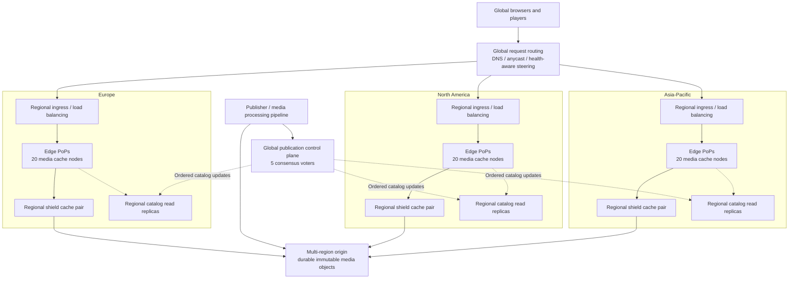
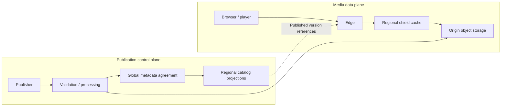
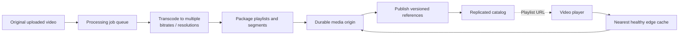
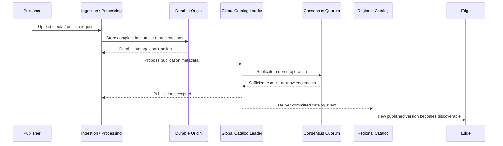
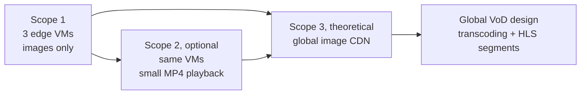

# Distributed Media CDN — Scope 3: Large-Scale System Architecture

**Document type:** Conceptual architecture and scalability design (**design only**)  
**Course:** Distributed Systems, University of Helsinki (2026)  
**Project:** Distributed CDN for an Image Gallery, extensible to Video-on-Demand (VoD)  
**Team:** Four students  
**Status:** Proposed reference architecture; subject to team review and instructor feedback  
**Implementation commitment:** **None of the additional infrastructure in this document is required to be built.**

**Related project documents:**

- [Scope 1 — Mandatory image-gallery prototype](distributed_cdn_image_gallery_scope1.md)
- [Scope 1 — Detailed scenarios](distributed_cdn_image_gallery_scope1_scenarios.md)
- [Scope 2 — Optional small-MP4 extension](distributed_cdn_media_gallery_scope2_video_extension.md)

> **Scope boundary.** Scope 1 implements a basic image CDN using **three independent edge VMs** that both cache media and agree on catalog updates. Scope 2, if attempted, adds small MP4 files and HTTP byte-range responses using the *same three-node architecture*. **Scope 3 describes a separate, production-scale target architecture** with geographically distributed edge caches, dedicated coordination services, resilient origins, and a video-processing pipeline. It is **not** a promise to implement any of these components during the course.
>
> This is a **proposed system design**, not a description of an existing deployed CDN. Node counts, regions, performance goals, and thresholds below are illustrative assumptions to enable architectural reasoning, not measured facts.

---

## 1. Purpose and problem statement

### 1.1 The application

The full system provides a **public media gallery** where visitors browse and retrieve published images. In its extended form, the same platform also distributes **on-demand videos**. A content publisher makes an image or video available, and users around the world access it via a stable public URL.

The gallery application owns user-facing concepts such as image titles and ordering. The **CDN** is the infrastructure that efficiently delivers the underlying media bytes. Keeping these responsibilities distinct avoids turning the CDN itself into a complete social or media-management platform.

### 1.2 Problems at global scale

A single origin server is a poor fit for a geographically distributed, read-heavy media platform because it introduces:

1. **Distance and latency:** distant users may need multiple long-distance round trips to fetch media.
2. **Bandwidth concentration:** repeated downloads of the same objects consume origin bandwidth.
3. **Availability risk:** an unavailable origin or network path may disrupt delivery to everyone.
4. **Traffic spikes:** a popular photograph or video can cause a sudden wave of identical requests.
5. **Storage and processing pressure:** larger video assets add capacity, throughput, and encoding demands.
6. **Consistency challenges:** cached replicas and regional catalog views may temporarily disagree about newly published versions.

A distributed CDN moves read traffic toward users, caches immutable copies, protects the origin from unnecessary requests, and coordinates publication metadata separately from ordinary content delivery.

### 1.3 Primary goals

- Serve published images with low latency and high cache reuse across multiple regions.
- Support videos as independently retrievable media representations, including adaptive streaming in the theoretical design.
- Maintain a single authoritative ordering of **publication and catalog changes**.
- Allow regional caches to operate independently of the consensus protocol on ordinary GET requests.
- Minimize long-distance origin traffic with regional cache tiers.
- Continue serving suitable already-published content through common edge and regional failures.
- Scale media-delivery capacity independently from the much smaller coordination infrastructure.
- Provide measurable latency, cache efficiency, synchronization, and availability behavior.

### 1.4 Non-goals for the course prototype

The following belong **only to Scope 3 design**: global DNS/anycast routing, worldwide Points of Presence (PoPs), dedicated metadata clusters, cross-region durable object storage, production identity and access control, automatic node placement/autoscaling, adaptive bitrate streaming, transcoding, global monitoring, and production-grade recovery. The prototype should not acquire these dependencies.

---

## 2. Scale assumptions and target environment

The architecture should be concrete enough to discuss capacity and failure domains. A possible **illustrative initial deployment** is:

| Area | Illustrative design assumption | Why it exists |
|---|---|---|
| Geographic regions | Europe, North America, Asia-Pacific | Different user populations and failure domains |
| Edge Points of Presence | 4 PoPs per region | Place caches at multiple network locations |
| Media-serving edge nodes | 5 nodes per PoP × 12 PoPs = **60 edges** | Parallel request serving and local caching |
| Regional parent/shield caches | 2 per region = **6 regional cache nodes** | Share cold misses and protect origins |
| Publication consensus voters | **5 metadata nodes** distributed across regions | One authoritative ordered publication log, quorum replication |
| Regional catalog/read replicas | At least 2 per region | Serve catalog reads near edges without global quorum on every GET |
| Origin/object storage | Redundant object stores across at least 2 regions | Durable source for published media |
| Publisher and processing services | Separate, horizontally scalable services | Validate uploads and prepare image/video representations |
| Clients | Browsers/mobile clients worldwide | Public read traffic and optional authenticated publishing |

The **60 edge nodes are cache/data-plane nodes, not 60 Raft voters**. In a production CDN it would be costly and unnecessary to perform consensus across every edge for every media operation. This differs intentionally from Scope 1, where all three required VMs participate in the replicated catalog to demonstrate course concepts.

Actual deployment sizes would depend on workload, cost, traffic distribution, cache hit rates, failure targets, and storage requirements; none are measured in this project.

---

## 3. High-level architecture

### 3.1 Global deployment topology



**Line semantics:** solid arrows indicate the principal request/content path; dashed arrows indicate metadata distribution or reads. The diagram represents logical services and regions, not one process per box. Multiple local caches and redundant instances are omitted for legibility.

### 3.2 Separate data and control planes

**Data plane (high-volume):** browser/player → global/region routing → edge cache → regional shield cache → origin if necessary → media response.

**Control plane (low-volume):** publisher → validated immutable origin objects → replicated publication decision → regional metadata projections → gallery listing/asset version selection.

The control plane does **not** sit on the path of every media byte. A previously published, immutable media URL remains fetchable without performing a consensus operation for that GET.



**Why this split matters:** media traffic grows with users and file sizes; publication traffic grows with content changes. Scaling the two subsystems independently avoids a consensus bottleneck on every image view or video segment request.

---

## 4. Component responsibilities and node roles

| Component | Core function | State and failure characteristics | Scaling approach |
|---|---|---|---|
| **Global routing layer** | Direct a visitor to a healthy/appropriate region | Uses routing/health policy; no media bytes stored | Multiple authoritative DNS/routing sites; redundant routing providers where justified |
| **Regional ingress/load balancers** | Distribute HTTP(S) requests across healthy edges | Operational health/routing state; not authoritative catalog | Horizontal replication per region/PoP |
| **Edge cache nodes** | Serve immutable images, video chunks and other static assets; cache on demand | Disposable local cache; can differ by node | Add edges/PoPs, size disks and network egress |
| **Regional parent/shield caches** | Share cold misses, fetch from origin, reduce origin connections | Larger, more persistent but still reconstructible cache | Redundant parent caches per region; capacity based on regional workload |
| **Origin/object storage** | Durable, authoritative media bytes indexed by immutable object key | Replicated durable data; failure must not silently corrupt content | Scale storage capacity and throughput independently; multiple failure domains |
| **Publisher / ingestion API** | Authorize uploads, validate files, create media IDs and publication requests | Short-lived requests and durable workflow state | Stateless API replicas with durable queue/state |
| **Media processing workers** | Produce image renditions; for video create encoding ladders, posters, playlists, segments | Asynchronous jobs; idempotent outputs | Worker pools; resource-isolate CPU/GPU-intensive workloads |
| **Global metadata consensus group** | Decide a single order of image/video publication, replacement and removal | Small durable replicated operation log; quorum needed for writes | Fixed-size 3- or 5-voter group; shard catalogs only after growth requires it |
| **Regional catalog/read service** | Serve nearby gallery listings and current-version lookups | Eventually updated projection of committed publication log | Several read replicas per region and topic partitions if necessary |
| **Monitoring/operations** | Collect health, traces, metrics, logs, alerting | Separate observability storage with retention | Aggregated regional collection and centralized reporting |

### 4.1 Important roles that should **not** be combined at scale

The three Scope 1 edges each host cache, catalog replica, and consensus participation. This is useful for the course prototype. In Scope 3, these functions are deliberately separated:

- **Edges** primarily handle media downloads and cache reads/writes.
- **Catalog read services** answer media listing/version requests close to users.
- **Consensus voters** decide authoritative publication ordering and do not transfer media content as part of the consensus log.
- **Origin storage** retains the durable file bytes, even when edge caches are empty or evicted.

The same organization can operate all services, but these are distinct architectural roles and typically distinct deployment pools.

---

## 5. Client routing and request distribution

The client needs only a URL such as `https://cdn.example.com/media/forest/v4/original.webp` or a gallery page URL. It does not need IP addresses for individual cache nodes.

### 5.1 Two-stage selection

1. **Global routing** chooses a suitable region or PoP based on network reachability, estimated performance, health and policy. Depending on the deployed network, this could use geography-aware DNS, anycast ingress, or a combination. **Geographically nearest is not always lowest-latency**; routing can consider network path and capacity.
2. **Regional or PoP load balancing** chooses a healthy edge server that will process the HTTP request.

The system does not guarantee that successive requests go to the same edge. Correctness must not depend on sticky sessions, because any edge can retrieve an immutable file from the regional tier or origin.

### 5.2 Health-aware behavior

- Exclude edge servers that fail readiness checks or exceed overload thresholds.
- Route around an unavailable PoP or region if routing systems detect the problem.
- Use short connection timeouts and bounded retries; avoid infinite request loops.
- Apply rate limits and connection controls before traffic reaches the origin.

**Design trade-off:** health-aware DNS can be affected by resolver caches and TTLs; anycast depends on network routing convergence. Neither produces instantaneous failover guarantees.

---

## 6. Media model, catalog and object naming

### 6.1 Distinguish three kinds of data

| Data kind | Example | Authority and consistency |
|---|---|---|
| **Gallery application metadata** | Title, description, gallery ordering, captions | Publisher/gallery service; can expose regional read models |
| **CDN publication catalog** | Media ID, committed version, object references, checksums, status | Globally ordered publication log; regional replicas may lag |
| **Media bytes and cached objects** | JPEG/WebP/AVIF, MP4, HLS playlists/segments | Immutable durable origin; edges contain disposable verified copies |

For the small prototype, the first two metadata roles can be the same replicated content catalog. At scale, they may be separate stores or projections because editorial queries and CDN delivery have different workloads.

### 6.2 Illustrative publication record

```json
{
  "asset_id": "forest",
  "catalog_revision": 1042,
  "published_version": 4,
  "media_type": "image",
  "status": "published",
  "renditions": [
    {
      "name": "original",
      "content_type": "image/jpeg",
      "object_key": "assets/forest/v4/original.jpg",
      "size_bytes": 245000,
      "sha256": "<sha256-of-immutable-object>"
    },
    {
      "name": "thumbnail",
      "content_type": "image/webp",
      "object_key": "assets/forest/v4/thumbnail.webp",
      "size_bytes": 26000,
      "sha256": "<sha256-of-immutable-object>"
    }
  ]
}
```

**Object rules:**

- Object keys include an asset version or content digest; **published object bytes are never overwritten in place**.
- Checksums/lengths identify the exact expected content, including for derived renditions.
- A new upload becomes visible only after all required objects are durably available.
- A catalog revision is distinct from an individual asset version; one revision may publish a change to one or more records.
- The CDN does **not** require an authoritative global list of which edge currently caches which object.

### 6.3 Cache keys and browser behavior

An example immutable image URL is:

`https://cdn.example.com/media/forest/v4/thumbnail.webp`

An updated image is published at a *new* path, such as `.../forest/v5/thumbnail.webp`, and the catalog changes its current-version pointer. Old cached versions cannot be mistaken for the new version if cache keys include the version and representation.

The **gallery listing endpoint** should have short freshness or revalidation rules because it points to the currently published versions. **Immutable versioned media URLs** may have longer cache lifetimes, subject to access/deletion requirements and HTTP caching rules.

### 6.4 Deletion and withdrawal policy

Withdrawal is different from an ordinary new version. A tombstone marks a media asset as unpublished; future gallery listings stop advertising it. Physical object deletion can occur later according to retention and garbage-collection policies.

**Important limitation:** a globally cached, immutable public URL may remain accessible until caches expire or purge completes. If immediate takedown or private-content revocation is a requirement, the design needs a stronger approach: authenticated access at delivery, fast global invalidation/denylisting, limited TTLs, and a stated maximum propagation window. The basic eventual-consistency model alone cannot promise instantaneous removal.

---

## 7. Image processing and delivery

### 7.1 Image publishing pipeline

At global scale, uploaded originals need not be served unchanged to every device. A background processing service can generate fixed, predefined variants such as thumbnails and high-resolution images.

```mermaid
flowchart LR
    UP["Authenticated upload"] --> VALID["Type/size checks<br/>security validation"]
    VALID --> STORE["Store immutable original"]
    STORE --> Q["Durable processing queue"]
    Q --> WORK["Image processing workers"]
    WORK --> OUT["Immutable image renditions<br/>stored in origin"]
    OUT --> PUBLISH["Publish catalog operation"]
    PUBLISH --> CONS["Metadata quorum agreement"]
    CONS --> PROP["Regional catalog propagation"]
```



This pipeline is **not implemented in Scope 1**. Scope 1 places a handful of existing images into origin storage through a script and publishes simple metadata.

### 7.2 Image retrieval hierarchy

For a versioned asset request, the recommended global retrieval order is:

1. Check the **selected edge's** cache.
2. On a miss, check its **regional parent/shield cache** (or an approved same-PoP peer if that offers a clear benefit).
3. On a parent miss, retrieve the immutable object from **origin storage**.
4. Verify the object against its expected metadata, store it atomically where appropriate, and return it to the user.

The Scope 1 prototype uses `local edge → peer edge → origin` because there are only three nodes. **Do not extrapolate an all-to-all peer search to 60 edges.** Regional tiers keep lookup costs and origin connections bounded.

### 7.3 Cache admission and eviction

Production edges have finite disk capacity. A reasonable design separates frequently accessed objects from rarely requested ones:

- Admit valid immutable objects to the cache, possibly with size or popularity thresholds.
- Evict objects using an approximate LRU/LFU policy, taking object size and recent access patterns into account.
- Prevent duplicate simultaneous upstream downloads of the same missing object (*request collapsing* or *single-flight*).
- Use per-object temporary files and atomically expose an object only after integrity checks succeed.
- Maintain a bounded cache budget per node; evictions affect performance, **not correctness**.

If an edge lacks an object, the origin remains authoritative, subject to availability. Evicting an object does not remove it from the publication catalog.

---

## 8. Full-scale video-on-demand architecture — theoretical only

**This section is distinct from Scope 2.** Scope 2 optionally serves small, complete MP4 files with basic browser playback/range requests. The full-scale design should accommodate much larger videos and adaptive streaming, but your group will **not build that pipeline**.

### 8.1 Media-processing pipeline

For on-demand video:

1. A publisher uploads an original video to durable ingestion storage.
2. An asynchronous workflow validates the asset and queues processing.
3. Workers encode multiple resolutions/bitrates and generate poster images.
4. The system packages videos into an HTTP-based adaptive streaming format, such as **HLS** or **MPEG-DASH**.
5. Segment files and playlists are stored under immutable, versioned keys.
6. After the complete published representation set is durable, a catalog operation makes the video version visible.
7. Clients fetch a playlist and subsequently request only the needed media segments from edge caches.



### 8.2 Streaming delivery

For HLS, a playlist references media segments; a master playlist can reference alternative bitrate variants. The player selects a variant and fetches individual segments over HTTP. This makes the segments ordinary cacheable CDN objects, rather than forcing every viewer to download a whole video. The exact player and segment behavior follows the chosen standard; it is not implemented in Scope 2.

**CDN cache keys:** include video asset ID, published version, rendition, and segment identifier. A segment must not be substituted from a different encoding or media version.

**Large-scale concerns:** video egress dominates bandwidth; cache admission and eviction must account for large objects, segment popularity, storage costs, and prefetch trade-offs. The CDN must also support partial object transfer where the delivery format requires it.

### 8.3 Video-specific optional capabilities

The design may mention caption tracks, multiple audio languages, live streaming, DRM/license systems, signed access tokens, and regional licensing restrictions as possible future requirements. **None is assumed to exist in the prototype**. Live streaming is a different ingestion and freshness problem and should not be presented as a straightforward feature of the course implementation.

---

## 9. Metadata synchronization, consistency and consensus

### 9.1 What requires agreement?

**Consensus applies to the authoritative sequence of publication operations** such as:

- `PUBLISH_IMAGE(asset_id, version, object_refs)`
- `PUBLISH_VIDEO(asset_id, version, representation_refs)`
- `UNPUBLISH_ASSET(asset_id)`
- `UPDATE_CATALOG_POINTER(asset_id, expected_version, new_version)`

A small quorum-based replicated state machine can impose a consistent operation order. For example, the theoretical design uses **five voting members** with a majority of **three** for commitment, subject to a correctly implemented consensus protocol.

**Consensus is *not* performed on cache hits, segment downloads, edge selection, or local cache eviction.** Those are read/data-plane concerns.

### 9.2 Suggested control-plane topology

- Five durable consensus voters distributed across failure domains (illustratively, 2 in Europe, 2 in North America and 1 in Asia-Pacific).
- One leader proposes ordered catalog updates and replicates operations to the voter group.
- Regionally deployed read services consume committed updates, apply them in order, and retain an `applied_revision` watermark.
- Edges consult nearby catalog/read services when they need an asset's currently published version; exact immutable media requests typically do not need this lookup.

A five-member quorum tolerates failure of **up to two voters** while the remaining connected majority can communicate, assuming the underlying consensus protocol's safety requirements are met. This does **not** mean arbitrary loss of two whole regions is tolerated; outcome depends on voter placement and network partitions.

**Trade-off:** a single global ordered publication log simplifies consistent content versioning but adds wide-area write latency and creates a centralized *logical* coordination dependency. This is acceptable as a first theoretical design for a read-heavy media gallery. If publication throughput later becomes a bottleneck, catalog namespaces can be partitioned into independent consensus groups, with more complex cross-partition semantics.

### 9.3 Publication sequence and durability boundary



**Invariants:**

1. **No catalog publication before the required media objects are durable and addressable** at the origin.
2. **No conflicting committed versions for the same catalog revision**; concurrent publisher requests must have defined ordering or compare-and-swap rejection semantics.
3. **Regional projections only apply committed operations** and record their last applied revision to detect gaps and replay missing updates.
4. **Retries are idempotent:** unique publication IDs prevent accidental duplicate versions after client or worker retries.
5. **Actual media bytes never enter the consensus log.** The log stores identifiers and metadata pointers only.

This is a conceptual sequence, not a complete Raft protocol trace. Correct leader elections, durability, stale-read behavior, and rejoining replicas depend on the selected implementation.

### 9.4 Different consistency guarantees for different data

| Data or operation | Proposed guarantee | Motivation / limitation |
|---|---|---|
| Catalog publication writes | Single ordered, quorum-committed authoritative log | Prevent conflicting *committed* publication decisions |
| Regional catalog replicas | **Eventual** application of committed log entries | Keep read latency low; a region can temporarily show an older gallery version |
| Exact versioned media URL | Immutable object identity and byte integrity | Same key should never refer to different bytes |
| Local edge cache membership | Local, best-effort state | Cache location is an optimization, not global truth |
| Per-object source integrity | Validate SHA-256 or a trusted strong digest | Detect corruption or wrong-version fetches |
| Sensitive content withdrawal | Separate stronger invalidation/authorization policy | Eventual propagation cannot promise immediate global revocation |

**Important read caveat:** an edge with lagging regional metadata can serve an *older gallery listing*, although the referenced immutable media remains internally consistent. A consensus write log **does not automatically make every regional read linearizable**. If an administrator requires an up-to-the-moment publication status, route that read to an appropriate quorum/leader-based read path rather than a stale regional projection.

### 9.5 Update propagation and invalidation

Use monotonically increasing catalog revisions, push/subscribe event delivery where feasible, periodic snapshots or checkpointed catch-up for slow regions, and explicit gap detection.

For normal updates, prefer **new immutable URLs** over attempting synchronous global purges. Regional catalogs switch current-version pointers as committed events arrive. Older versions can expire naturally or be cleaned up later. Urgent takedowns require a separate policy as described in §6.4.

---

## 10. Fault tolerance, failures and recovery

Failure handling must distinguish **media availability** from **ability to publish new metadata**. The CDN can keep serving existing objects even if the publication control plane is unavailable.

| Failure | Expected architecture behavior | Remaining limitation |
|---|---|---|
| Single edge process/VM fails | Regional load balancer stops choosing it; other edges serve | Some clients experience timeouts during health detection |
| A whole PoP fails | Global/regional routing shifts users toward another PoP | Latency and capacity may degrade |
| One regional shield cache fails | Other shield/cache path handles cold misses | Higher miss traffic and origin load |
| Origin endpoint fails | Another origin replica serves; warm cached objects continue | Uncached data unavailable if all origin replicas/pathways fail |
| Metadata leader crashes | Consensus voters elect a new leader when a majority can communicate | Catalog writes may pause during election |
| Quorum unavailable | Reject/defer new publication operations | Existing immutable media may remain readable |
| Region isolated by WAN partition | Local caches can serve existing versioned media; regional catalog stops or lags | No guarantee of latest listing; publication availability depends on quorum placement |
| Edge has corrupted cached object | Detect digest mismatch; delete/quarantine and refetch | Request may fail if no healthy source exists |
| Processing job fails | Retry idempotently; keep asset unpublished until complete | Publication delayed |
| Regional catalog lag/restart | Replay committed events from last revision or restore checkpoint | Temporarily stale catalog responses |

### 10.1 Failure-domain design

- Run multiple edge instances per PoP and multiple PoPs per region.
- Deploy regional cache parents in separate failure domains.
- Replicate origin objects across independent storage fault domains and preferably multiple regions before declaring publication successful.
- Spread metadata voters across locations and ensure a reachable quorum survives the selected failure scenarios.
- Keep client-serving paths independent from mandatory control-plane RPCs whenever possible.

**No architecture can guarantee availability under all failures.** For network partitions, choose and explain trade-offs instead of promising both globally latest catalog reads and uninterrupted updates everywhere.

### 10.2 Startup and recovery

A recovered cache server can start empty and repopulate on demand. A recovered metadata service needs durable logs, snapshots or replay mechanisms to catch up before being trusted for authoritative decisions. These are fundamentally different recovery problems and should be documented separately.

---

## 11. Scalability and bottleneck analysis

### 11.1 Scaling each subsystem

| Bottleneck | Approach to scale | Cost or trade-off |
|---|---|---|
| Too many user requests | Add edge nodes and regional ingress capacity | More machines/network egress; operational overhead |
| Low cache hit ratio | Increase relevant cache capacity; use parent caches | More disk; possible extra hop on misses |
| Origin overload | Request collapsing, shield tiers, replication, origin concurrency limits | Extra caching/coordination complexity |
| Excessive inter-edge lookup | Replace full-mesh peer searches with local/regional tiers | Additional hierarchy and cache placement decisions |
| Large media files | Size-aware cache admission, segmented video objects | More metadata/objects; cache-fragmentation concerns |
| Catalog read traffic | Add regional read replicas, partition listing queries | Possible stale regional views |
| Metadata publication throughput | Batch operations or shard catalogs into independent replication groups | Harder coordination for cross-shard operations |
| Transcoding throughput | Scale asynchronous processing workers separately | Compute cost; queueing delay |
| Global network variability | Regional steering and resilient inter-region routes | Routing policy and health detection complexity |

### 11.2 Why a full mesh does not scale

Scope 1 uses three edges, each directly exchanging messages with both others. Three nodes have only three unique undirected peer links. At 60 edges, a full mesh would have:

\[
\frac{60\times59}{2}=1,770\text{ peer pairs}
\]

This is not inherently impossible, but querying every other edge for each miss or maintaining extensive all-to-all coordination creates needless message overhead. A hierarchy of PoPs, parent caches and small metadata groups is more appropriate.

### 11.3 Illustrative capacity calculation (not a performance claim)

If the system receives **5,000 object requests per second**, with an illustrative average response size of **300 KiB**, aggregate media egress is roughly:

- `5,000 × 300 KiB/s ≈ 1.46 GiB/s` of payload;
- approximately **12.3 Gbit/s** before network and protocol overhead.

If the edge-hit ratio is **90%**, then only about **500 requests/s** miss the first cache tier in this simplified model. A regional shield may absorb additional misses before they reach the origin. These figures are *arithmetic examples*, not forecasts: video segment sizes and regional demand distributions can differ dramatically from this assumed average.

### 11.4 Performance model and target metrics

The following are useful **design evaluation metrics**, not guaranteed service levels:

| Metric | Definition / question answered |
|---|---|
| Edge cache hit ratio | Fraction of eligible requests served from the selected edge's local cache |
| Parent cache hit ratio | Fraction of edge misses satisfied by regional shield caches |
| Origin offload ratio | How much request/byte traffic avoids the origin? |
| End-to-end latency | p50/p95/p99 response latency by region, media type and cache source |
| Time to first byte | How quickly does a cached or cold object begin delivery? |
| Egress throughput | Bytes delivered per second per region, PoP and server |
| Metadata commit latency | Time from publication proposal to authoritative commit |
| Catalog propagation lag | Time/revision distance between global commit and regional visibility |
| Cache fill time | Time to obtain, validate and store an uncached immutable object |
| Error and availability rates | Failures per request, broken down by layer and cause |
| Video-specific | Segment request latency, startup delay, buffering ratio, selected bitrate |

The **three-VM course prototype** can collect some of these metrics under controlled local conditions, but it cannot establish real worldwide latency or global availability. Large-scale estimates belong to the architectural discussion, and should be labeled accordingly.

---

## 12. Security, privacy and operational safeguards (design only)

Even a public gallery needs a security boundary around media publication and infrastructure administration.

### 12.1 Suggested production controls

- **HTTPS/TLS** on public delivery endpoints; authenticated service-to-service communication where sensitive control messages are exchanged.
- **Authenticated publishing and role-based authorization** for administrators; public users cannot call publication APIs.
- Validate uploaded media type, size and content; constrain paths and reject path traversal, malformed object keys and oversized payloads.
- Prevent cache poisoning by accepting origin objects only from trusted locations and checking object identity/integrity.
- Rate-limit requests, protect origins against excessive requests, and consider a WAF and DDoS-mitigation layer.
- Keep origin storage private to approved delivery/processing infrastructure when possible.
- Distinguish **public** and **private** media. Sensitive/private content requires authorization-aware cache keys and usually signed access or another authenticated delivery model; do not use a public shared cache policy blindly.
- Maintain audit logs for publication, deletion and administrative changes.
- Apply retention policies and a withdrawal procedure for removed media.

### 12.2 Observability and incident response

Each service should emit structured logs with timestamps, request/correlation IDs, region/PoP, object key, cache source, error category, and publication revision where relevant.

Metrics should be collected regionally and rolled up centrally. Distributed traces can connect a client request with edge, shield and origin activity, while event-log traces show publication/replication progress.

Operational alerts could cover unusually high origin miss rates, sustained p95 latency, regional catalog lag, high 5xx error rates, origin unavailability, low disk capacity, and inability to form a metadata quorum.

These monitoring services are **supporting infrastructure**; they are not the authoritative content state and should not be counted as consensus participants merely because they receive logs.

---

## 13. Interfaces and data contracts at scale

These are **logical examples** used to clarify responsibilities, not endpoints that the four-student team must implement.

| Logical API / event | Producer → Consumer | Purpose |
|---|---|---|
| `GET /api/gallery?cursor=...` | Client → regional gallery read service | Paginated published catalog view |
| `GET /media/{id}/v{version}/{representation}` | Client → CDN edge | Fetch a specific immutable image representation |
| `GET /video/{id}/v{version}/master.m3u8` | Player → CDN edge | Retrieve a published HLS playlist |
| `GET /video/{id}/v{version}/{variant}/{segment}` | Player → CDN edge | Retrieve one immutable video segment |
| `POST /publisher/assets` | Authenticated publisher → ingestion | Store new media and start processing workflow |
| `POST /publisher/assets/{id}/publish` | Publisher service → publication control plane | Propose a new authoritative catalog version |
| `CATALOG_COMMITTED(revision, operation)` | Consensus service → regional projection | Apply ordered publication event |
| `GET /internal/health` | Operators / load balancers → service | Determine readiness/liveness |

**Control-plane correctness contracts:** idempotent publication ID, expected-version check when appropriate, commit revision, exact object references, durable publication audit trail, and replayable catalog events.

**Data-plane correctness contracts:** exact immutable version, correct MIME type, bounded timeouts, checksum/digest where applicable, proper cache headers, clear 404/5xx behavior, and compliant byte-range handling for formats/endpoints that support ranges.

---

## 14. Design trade-offs and open decisions

| Design decision | Chosen reference approach | Alternative / trade-off |
|---|---|---|
| Global metadata writes | One small 5-voter consensus group | Partition by namespace when write scale warrants it; harder cross-partition semantics |
| Regional metadata reads | Asynchronous committed-log projections | Strong reads against quorum/leader increase WAN latency and coupling |
| Edge data location | Hierarchical edge → regional shield → origin | Full-mesh peer gossip can reduce some misses but adds discovery complexity |
| Cache coherence | Immutable versioned keys and catalog pointer updates | Global purge of mutable paths creates harder invalidation requirements |
| Origin data durability | Replicated object storage across failure domains | Single origin is simpler but risks availability and loss |
| Video delivery | Segmented adaptive VoD in Scope 3 design | Whole MP4s as in Scope 2 are simpler but inefficient at global scale |
| Cache allocation | Demand-based, bounded local caches | Full replication of every media object would waste space and bandwidth |
| Takedown | Tombstone + controlled invalidation/authorization for urgent cases | Long-lived immutable public URLs make immediate deletion difficult |
| Deployment | Cloud/VM-neutral service architecture | A managed cloud implementation may be simpler operationally but provider-specific |

**Decisions still requiring the team's own justification:** which catalog data fields are genuinely authoritative; which operations need strong global ordering; which failure scenarios the consensus placement should tolerate; desired catalog freshness; acceptable content withdrawal time; CDN cache policies by object type; and whether the theoretical target includes private media or public media only.

---

## 15. Relationship to Scope 1 and Scope 2

| Aspect | **Scope 1: mandatory implementation** | **Scope 2: optional implementation** | **Scope 3: design only** |
|---|---|---|---|
| Media supported | Static gallery images | Images + a few small MP4s | Images + full on-demand video representations |
| Deployment | Three distinct edge VMs + host origin/LB/client | Same three VMs, no additional nodes | ~60 globally distributed edges, shields, control-plane and origin redundancy |
| Edge communication | Each edge communicates directly with both others | Unchanged | Regional hierarchy; **not all-to-all globally** |
| Catalog | Replicated image manifest on three edges | Generalized media manifest | Dedicated global publication control plane and regional read projections |
| Agreement | Three edge nodes participate in agreement | Same agreement path | Small dedicated consensus group, separate from edges |
| Caching | Full image objects, local → peer → origin | Full MP4s, range response when cached | Tiered caches, object size/policy, video segments |
| Request routing | One local Nginx balancer | Same local balancer | Global route selection + regional/PoP load balancing |
| Publishing | Script/manual placement of versioned images | Extend publisher for small MP4s | Authenticated ingestion, durable processing, publish after ready |
| Fault handling | Selected limited cases, documented assumptions | Same limits | Multi-PoP/region failover, recovery, durable storage |
| Scalability claims | Architecture and measurements of tiny testbed only | Limited local comparisons | Capacity/bottleneck analysis and architectural rationale |
| Deliverables | Working code + docs + demo | Only if Scope 1 complete | **Architecture diagrams, trade-off analysis and report text; no code required** |

### 15.1 Architectural evolution path



**Important:** Scope 3 is an architectural *evolution*, **not a linear deployment of the exact Scope 1 software to 60 machines**. The move to global scale deliberately changes how nodes are grouped and where consensus lives. This architectural redesign is part of the analysis the course expects; it does not invalidate the learning-oriented prototype.

---

## 16. How Scope 3 addresses course assessment criteria

The course description requires a large-scale design that discusses distributed state, synchronization/consistency, consensus, fault tolerance, scalability and performance, while the smaller prototype demonstrates core distributed features. Scope 3 specifically provides the rationale for the larger architecture and its trade-offs.

| Course viewpoint | Scope 3 design evidence | Scope 1 implementation evidence |
|---|---|---|
| **Shared distributed state** | Publication log, catalog read projections, regional update watermarks; immutable media references | Three replicated image catalogs |
| **Consistency and synchronization** | Globally ordered publications; asynchronous regional update distribution; versioned URLs | Catalog synchronization and version checks |
| **Consensus** | Five-member metadata voter group, leader/quorum concept, defined write/read boundary | Three edge consensus participants using the selected implementation |
| **Fault tolerance** | Redundant PoPs, cache shields, origin replicas, quorum failure behavior and recovery | Limited edge/leader failure demonstrations, subject to implementation |
| **Scalability** | Regional cache tiers, horizontal edge scaling, read replicas, bounded peer discovery | Explain architecture; no large-scale test required |
| **Performance** | Cache/offload/latency model, bottlenecks, throughput assumptions, measurement plan | Cache and metadata timing metrics from three VMs |
| **Node roles / communication** | Explicit data/control plane, roles, protocols and diagrams | Three VMs with two peer communication partners each |

The team's final report should **distinguish intended large-scale behavior from properties actually measured or verified in Scope 1**. Do not claim that a three-VM prototype proves global failover, worldwide throughput, or regional latency benefits.

---

## 17. Suggested organization in the final course report

Relevant parts of this document can be condensed into the following report sections:

1. **Vision and expected scale:** problem, public media workload, number and role of nodes.
2. **Architecture:** global routing, regional edge caches, shield tiers, durable origin, separate publication control plane.
3. **Data and consistency:** immutable objects, catalog model, consensus boundary, regional propagation and read semantics.
4. **Fault tolerance:** failure domains, quorum behavior, regional failover and origin/cache recovery.
5. **Scalability and performance:** bottleneck analysis, scaling mechanisms, target metrics and explicitly labeled illustrative capacity calculations.
6. **Prototype relationship:** why Scope 1 combines roles, what it actually implements, what is only designed, and what results support the claims.
7. **Design trade-offs:** why a globally full-mesh CDN and consensus on media GETs are rejected.

Detailed interaction scenarios, test steps, and demonstration scripts remain in the **separate scenarios document**, not here.

---

## 18. References and source boundaries

### Course and companion documents

- *Distributed Systems — Project 2026*, University of Helsinki (provided course handout): particularly the large-scale design requirement; three-node prototype, all-to-all participant connectivity; shared state/consistency/consensus; fault-tolerance/scalability discussion; and performance reporting expectations.
- [Scope 1 architecture](distributed_cdn_image_gallery_scope1.md) and [Scope 2 video extension](distributed_cdn_media_gallery_scope2_video_extension.md): project-established terminology and prototype constraints.

### Public technical references

- [Cloudflare — CDN Reference Architecture](https://developers.cloudflare.com/reference-architecture/architectures/cdn/): edge caching, origin load reduction, request routing, and tiered cache principles. **Our proposed topology is not presented as Cloudflare's actual deployment.**
- [RFC 9111 — HTTP Caching](https://www.rfc-editor.org/rfc/rfc9111.html): HTTP response caching, validation, freshness and relevant cache behavior.
- [RFC 9110 — HTTP Semantics](https://www.rfc-editor.org/rfc/rfc9110.html): HTTP methods and range requests.
- [RFC 8216 — HTTP Live Streaming](https://www.rfc-editor.org/rfc/rfc8216.html): HLS playlists, media segments and variant streams.
- [Raft — Consensus Algorithm](https://raft.github.io/): replicated logs, leader election and quorum-based consensus principles.

**Source boundary:** The general CDN/HTTP/HLS/Raft concepts are informed by the references above. The **specific proposed number of regions/nodes, service split, publication workflow, failure policies, scaling assumptions and deployment plan are this project's architectural design choices**, not requirements or claims taken from these sources.

---

**Bottom line:** The large-scale CDN is designed around **globally distributed, independently scalable media caches** and a **small, replicated publication control plane**. Immutable media versions allow edges to cache and deliver images/videos without coordinating every request. This design preserves the distributed-systems concepts of Scope 1 while acknowledging that a global system requires a different topology, richer failure handling and much stronger operational infrastructure—all of which remain **design-only for the course project**.
